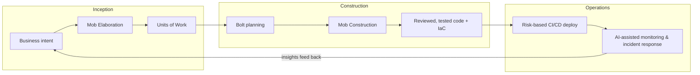

# 01 — The AI-DLC Methodology

AI-DLC (AI-Driven Development Lifecycle) is AWS's methodology for building software with AI as the primary executor and humans as validators and decision-makers. It was introduced by AWS in 2025 as a deliberate replacement for retrofitting AI tools onto Scrum. This chapter defines the method and the vocabulary used throughout this playbook.

## Why a new lifecycle at all

This section is for anyone new to AI-DLC, including people who will never drive an agent themselves: what changed, what goes wrong without a method, and what the method asks of you. The rest of the playbook is the *how*; this is the *why*.

### What changed

For as long as there has been software, writing the code was the slow, expensive part. Every process we use grew up around that fact. Scrum's two-week sprints, story-point estimates, backlog grooming, and the handoffs from analyst to developer to tester all ration scarce developer hours.

AI agents change the economics. An agent can read a codebase, propose a plan, and produce working code, tests, and infrastructure for a well-described change in hours rather than weeks. When producing code is fast and cheap, the hard parts are the ones that were always hard, but now there is nothing to hide behind:

- **Deciding what to build.** An agent builds exactly what it is told, quickly. A vague requirement used to cost a slow, wrong feature; now it costs a fast, wrong feature, several times over.
- **Checking that it is right.** Agent-written code looks confident and idiomatic whether or not it is correct. Someone has to read it with judgment, and there is far more of it to read.
- **Keeping it safe and maintainable.** Security flaws, poor designs, and inconsistencies can now be produced at the same speed as good code.

A lifecycle designed around the old bottleneck puts its effort in the wrong place. AI-DLC moves the effort to where the risk now is: intent up front, and validation throughout.

### What goes wrong without a method

Organizations that adopt AI coding tools without changing how they work tend to land in one of two places.

1. **AI-assisted Scrum.** The tools are added to the same sprints, estimates, and handoffs. Individuals get faster, but the process around them does not, so the gain is modest. The ceremony becomes the bottleneck instead of the code, and the organization concludes AI is overhyped.
2. **Uncontrolled generation.** People let agents run with little structure. Output volume climbs, and so do the problems nobody sees at first: large diffs nobody really reviewed, tests that confirm bugs instead of catching them ([Chapter 02](02-ways-of-working.md#testing-under-ai-dlc)), insecure patterns repeated across services ([Chapter 06](06-security-shift-left.md#the-threat-picture-under-ai-dlc)), and developers who can no longer debug what their agents wrote ([Chapter 11](11-learning-paths.md#keeping-skills-while-the-agent-codes)). The speed is real, and so is the debt.

AI-DLC is the path between these: change the process so the speed is used, and put gates in it so the speed is safe.

### Why a lifecycle and not just a tool

A tool changes what one person can do. A lifecycle changes what an organization can rely on. Three things only come from a shared method:

- **Gains that repeat.** When every pod works the same way, what one pod learns (a steering line, a skill, a new check) reaches every other pod the same week ([Chapter 03](03-tooling-strategy.md#why-a-primary-agent-instead-of-letting-everyone-pick)). Ten people each improvising with their own tool produce ten sets of habits and no shared asset.
- **Trust in the output.** Every change passes the same [validation gates](#the-validation-gates), so a leader, an auditor, or a customer can rely on AI-built software without taking anyone's word for it.
- **An audit trail for free.** Intent, plan, code, review, and deployment are linked for every change ([Chapter 08](08-github-jira.md#traceability-the-audit-trail-for-free)), which answers "why is this code here, and who approved it?" years later.

### What it means for you

| If you are | What changes | Why it matters |
|---|---|---|
| A developer | You spend less time typing code and more time planning with the agent, reviewing its output, and improving the steering it follows | Review is now the main engineering skill, and the quality of your judgment sets the quality of the product ([Chapter 02](02-ways-of-working.md#review-culture-the-biggest-change)) |
| A product owner | You decide requirements live, in the room, in [Mob Elaboration](#phase-1-inception), instead of queueing tickets | The agent builds exactly what the acceptance criteria say, so their clarity is now the biggest lever on what gets built |
| QA | You verify that the tests test the right thing, rather than running regression suites by hand | Agents generate tests easily, including tests that confirm bugs; judging the tests is the new QA work |
| A security engineer | You write the rules agents follow, and review threat models at the start of each Unit of Work | One steering line prevents a vulnerability class in every future change ([Chapter 06](06-security-shift-left.md)) |
| A leader | You measure validated outcomes and lead time, not activity, and budget for tokens and enablement | Old measures such as lines of code and story points become meaningless or misleading when code is cheap ([Chapter 02](02-ways-of-working.md#metrics-that-matter-and-ones-that-dont)) |

### What it does not mean

- **It does not mean the AI decides.** People decide what to build, approve every plan, and review every change before it merges. The agent proposes; people dispose.
- **It does not mean less rigor.** There are more checks, not fewer; they are placed where agent mistakes actually happen.
- **It does not settle questions about jobs.** Whether and how team shapes change is an organizational decision, and it should be answered honestly and in writing, not assumed ([Chapter 12](12-adoption-strategy.md#handling-the-hard-objections)).

### The idea in one sentence

AI-DLC inverts the traditional model:

> **AI orchestrates the process — generating plans, code, tests, and infrastructure at each stage — and humans verify and approve before execution proceeds.**

Two things must both be true for this to work:

1. **AI proposes, humans dispose.** Every stage produces artifacts a human reviews before they become load-bearing. Autonomy without validation gates is how you ship confident nonsense.
2. **Context is engineered, not assumed.** Agents are only as good as the intent, standards, and domain knowledge you give them. Steering files, domain models, and templates are first-class engineering artifacts (see [Chapter 03](03-tooling-strategy.md) and [Chapter 04](04-architecture.md)).

## The vocabulary

| Traditional | AI-DLC | What changed |
|---|---|---|
| Epic / feature | **Unit of Work** | A business intent plus everything needed to execute it: stories, acceptance criteria, risks, domain context. Written *with* AI during Mob Elaboration. |
| Sprint (2 weeks) | **Bolt** | An intense execution cycle measured in **hours to days**. A Bolt takes one Unit of Work (or a slice of one) from plan to reviewed, tested, deployable code. |
| Scrum team (7±2) | **AI Pod** | 2–3 developers working mob-style with AI agents. Smaller teams, dramatically higher throughput, no handoffs. |
| Backlog grooming | **Mob Elaboration** | A synchronous session where the pod, product, and QA translate business intent into Units of Work — with AI generating drafts and clarifying questions in real time. |
| Sprint execution | **Mob Construction** | The pod works together while agents generate code, tests, and IaC; humans review continuously rather than at the end. |
| Center of Excellence | **Community of practice** | A voluntary, cross-team network of practitioners that owns the practice and improves it through normal PRs, with no approval authority. Adoption spreads by evidence and peers, not by a central gate ([Chapter 12](12-adoption-strategy.md#the-community-of-practice)). |

These six are the core; every other term the playbook uses with a specific meaning is in the [glossary](../GLOSSARY.md), one entry per term, each linking back to its defining chapter.

## The three phases

### Phase 1: Inception

**Goal:** turn business intent into validated Units of Work.

The pod, product owner, and QA meet in **Mob Elaboration**. The AI's role is to be the tireless analyst: it drafts requirements from the stated intent, generates the clarifying questions humans forget to ask ("what happens when the payment provider times out mid-refund?"), proposes a decomposition into Units of Work, and flags risks and cross-cutting concerns — including security, which enters *here*, not at review time ([Chapter 06](06-security-shift-left.md)).

Humans do what only humans can: decide what the business actually wants, resolve ambiguity, and reject plausible-sounding requirements that are wrong.

**Exit criteria:** each Unit of Work has an intent statement, user stories with acceptance criteria, identified risks, and enough domain context that an agent could start work without asking who the actors are. Use the [Unit of Work template](../standards/unit-of-work-template.md).

### Phase 2: Construction

**Goal:** turn Units of Work into production-quality, reviewed code.

Work happens in **Bolts**. A Bolt begins with the agent proposing an implementation plan for the Unit of Work; the pod reviews and approves the plan *before* code generation starts (plan-then-execute — never let an agent free-run into a large diff). Then, in **Mob Construction**, agents generate code, tests, security validations, and infrastructure-as-code while the pod reviews continuously, steers, and handles judgment calls.

Key disciplines:

- **Plan approval gate:** no significant generation without an approved plan. The plan follows the [Bolt plan template](../standards/bolt-plan-template.md), whose stop conditions tell the agent when to halt and re-plan.
- **Tests are written first, from the acceptance criteria, and fail before the code exists** ([Chapter 02](02-ways-of-working.md#testing-under-ai-dlc)). The agent validates its own work against them; humans validate the tests themselves (a test that asserts the bug is worse than no test).
- **Documentation updates ride along** with each change — the agent updates the relevant markdown as part of the diff ([Chapter 09](09-documentation-standards.md)).
- **Small, reviewable increments.** If a diff is too large to review, the Unit of Work slice was too large. Split the Bolt.

**Exit criteria:** code reviewed by a human, tests green, security scans clean, docs updated, deployable artifact produced.

### Phase 3: Operations

**Goal:** deploy safely and learn continuously.

AI-generated IaC deploys through CI/CD with **risk-based gates**: routine changes flow through automated validation; material changes (schema migrations, auth changes, public API changes) require human approval ([Chapter 07](07-devops-automation.md)). In production, agents do first-line incident investigation — correlating alerts, logs, and recent deploys into a hypothesis a human confirms. Operational insights feed back into the next Inception.

## The validation gates

The gates are the methodology. Remove them and you have autopilot, not AI-DLC.

| Gate | Who validates | What they're checking |
|---|---|---|
| Unit of Work approval | Product + pod | Is this the right thing to build? Is the intent unambiguous? |
| Bolt plan approval | Pod | Is this the right way to build it? Right files, right approach, right scope? ([Bolt plan template](../standards/bolt-plan-template.md)) |
| Continuous code review | Pod (during Mob Construction) | Correctness, security, fit with architecture and conventions |
| Merge gate | Human reviewer + CI | Tests, scans, standards — evidence, not assertion |
| Deploy gate (material changes) | Pod lead / on-call | Blast radius, rollback plan |

## Anti-patterns

- **"AI-assisted Scrum."** Keeping two-week sprints and story-point poker while adding Copilot. You get 10% gains and conclude AI is overhyped.
- **The 5,000-line PR.** An agent free-ran for a day and someone now has to review a novel. Nobody reviews it properly. Enforce plan gates and small Bolts.
- **Skipping Mob Elaboration** because "the ticket is clear." Agents amplify ambiguity into confidently wrong systems. The cheapest place to fix a misunderstanding is before generation.
- **Rubber-stamp validation.** If humans approve everything without reading, gates are theater. Track review depth (comments per review, defects caught at gate vs. in production).
- **Measuring lines of code.** Throughput of *validated Units of Work* is the metric. LOC is now nearly free and therefore meaningless.

## Tips & tricks

- **Timebox Mob Elaboration to 90 minutes per Unit of Work.** If it takes longer, the intent is too big — split it.
- **Keep a "questions the AI asked" log.** The clarifying questions agents raise in elaboration are a goldmine for improving your intent-writing.
- **Start Bolts in the morning.** A Bolt wants sustained pod attention; don't start one at 4pm.
- **One pod, one Unit of Work at a time.** Parallelizing Units across a 3-person pod recreates handoffs and kills the mob dynamic. Parallelize the slices of one approved plan instead ([fan-out](02-ways-of-working.md#fan-out-inside-a-bolt)).
- **Pilot on a real but low-risk service** — not a toy (nobody believes toy results) and not the payments core (one incident kills the program). See [Chapter 11](11-learning-paths.md) for the rollout program and [Chapter 12](12-adoption-strategy.md) for earning buy-in to it.

## References

- [AWS: AI-Driven Development Lifecycle for Financial Services](https://aws.amazon.com/blogs/industries/ai-driven-development-lifecycle-for-financial-services/)
- [IBM Think: AI-DLC explained](https://www.ibm.com/think/topics/ai-dlc)
- Next: [Chapter 02 — Ways of Working](02-ways-of-working.md) · To see the whole loop with every artifact filled in: [Appendix A — Worked Example](appendix-a-worked-example.md)
