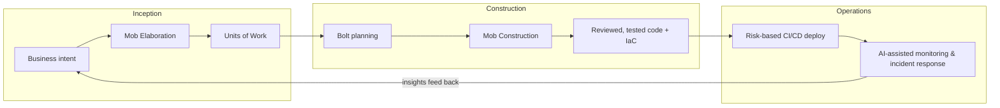

# 01 — The AI-DLC Methodology

AI-DLC (AI-Driven Development Lifecycle) is AWS's methodology for building software with AI as the primary executor and humans as validators and decision-makers. It was introduced by AWS in 2025 as a deliberate replacement for retrofitting AI tools onto Scrum. This chapter defines the method and the vocabulary used throughout this playbook.

## Why a new lifecycle at all

Bolting AI assistants onto an unchanged Scrum process yields modest gains because the process itself assumes human speed: two-week sprints, backlog grooming, handoffs between specialists. When an agent can produce a tested feature in an afternoon, the ceremony becomes the bottleneck, not the code.

AI-DLC inverts the model:

> **AI orchestrates the process — generating plans, code, tests, and infrastructure at each stage — and humans verify and approve before execution proceeds.**

Two things must both be true for this to work:

1. **AI proposes, humans dispose.** Every stage produces artifacts a human reviews before they become load-bearing. Autonomy without validation gates is how you ship confident nonsense.
2. **Context is engineered, not assumed.** Agents are only as good as the intent, standards, and domain knowledge you give them. Steering files, domain models, and templates are first-class engineering artifacts (see [Chapter 03](03-tooling-strategy.md) and [Chapter 04](04-architecture.md)).

## The vocabulary

| Traditional | AI-DLC | What changed |
|---|---|---|
| Epic / feature | **Unit of Work** | A business intent plus everything needed to execute it: stories, acceptance criteria, risks, domain context. Written *with* AI during Mob Elaboration. |
| Sprint (2 weeks) | **Bolt** | An intense execution cycle measured in **hours to days**. A Bolt takes one Unit of Work (or a slice of one) from plan to reviewed, tested, deployable code. |
| Scrum team (7±2) | **AI Pod** | 2–3 developers working mob-style with AI agents. Smaller teams, dramatically higher throughput, no handoffs. |
| Backlog grooming | **Mob Elaboration** | A synchronous session where the pod, product, and QA translate business intent into Units of Work — with AI generating drafts and clarifying questions in real time. |
| Sprint execution | **Mob Construction** | The pod works together while agents generate code, tests, and IaC; humans review continuously rather than at the end. |

## The three phases

### Phase 1: Inception

**Goal:** turn business intent into validated Units of Work.

The pod, product owner, and QA meet in **Mob Elaboration**. The AI's role is to be the tireless analyst: it drafts requirements from the stated intent, generates the clarifying questions humans forget to ask ("what happens when the payment provider times out mid-refund?"), proposes a decomposition into Units of Work, and flags risks and cross-cutting concerns — including security, which enters *here*, not at review time ([Chapter 06](06-security-shift-left.md)).

Humans do what only humans can: decide what the business actually wants, resolve ambiguity, and reject plausible-sounding requirements that are wrong.

**Exit criteria:** each Unit of Work has an intent statement, user stories with acceptance criteria, identified risks, and enough domain context that an agent could start work without asking who the actors are. Use the [Unit of Work template](../standards/unit-of-work-template.md).

### Phase 2: Construction

**Goal:** turn Units of Work into production-quality, reviewed code.

Work happens in **Bolts**. A Bolt begins with the agent proposing an implementation plan for the Unit of Work; the pod reviews and approves the plan *before* code generation starts (plan-then-execute — never let an agent free-run into a large diff). Then, in **Mob Construction**, agents generate code, tests, security validations, and infrastructure-as-code while the pod reviews continuously, steers, and handles judgment calls.

Key disciplines:

- **Plan approval gate:** no significant generation without an approved plan. The plan follows the [Bolt plan template](../standards/bolt-plan-template.md), whose stop conditions tell the agent when to halt and re-plan.
- **Tests are generated with the code, not after.** The agent validates its own work against them; humans validate the tests themselves (a test that asserts the bug is worse than no test).
- **Documentation updates ride along** with each change — the agent updates the relevant markdown as part of the diff ([Chapter 09](09-documentation-standards.md)).
- **Small, reviewable increments.** If a diff is too large to review, the Unit of Work slice was too large. Split the Bolt.

**Exit criteria:** code reviewed by a human, tests green, security scans clean, docs updated, deployable artifact produced.

### Phase 3: Operations

**Goal:** deploy safely and learn continuously.

AI-generated IaC deploys through CI/CD with **risk-based gates**: routine changes flow through automated validation; material changes (schema migrations, auth changes, public API changes) require human approval ([Chapter 07](07-devops-automation.md)). In production, agents do first-line incident investigation — correlating alerts, logs, and recent deploys into a hypothesis a human confirms. Operational insights feed back into the next Inception.

## The validation gates

The gates are the methodology. Remove them and you have autopilot, not AI-DLC.

| Gate | Who validates | What they're checking |
|---|---|---|
| Unit of Work approval | Product + pod | Is this the right thing to build? Is the intent unambiguous? |
| Bolt plan approval | Pod | Is this the right way to build it? Right files, right approach, right scope? ([Bolt plan template](../standards/bolt-plan-template.md)) |
| Continuous code review | Pod (during Mob Construction) | Correctness, security, fit with architecture and conventions |
| Merge gate | Human reviewer + CI | Tests, scans, standards — evidence, not assertion |
| Deploy gate (material changes) | Pod lead / on-call | Blast radius, rollback plan |

## Anti-patterns

- **"AI-assisted Scrum."** Keeping two-week sprints and story-point poker while adding Copilot. You get 10% gains and conclude AI is overhyped.
- **The 5,000-line PR.** An agent free-ran for a day and someone now has to review a novel. Nobody reviews it properly. Enforce plan gates and small Bolts.
- **Skipping Mob Elaboration** because "the ticket is clear." Agents amplify ambiguity into confidently wrong systems. The cheapest place to fix a misunderstanding is before generation.
- **Rubber-stamp validation.** If humans approve everything without reading, gates are theater. Track review depth (comments per review, defects caught at gate vs. in production).
- **Measuring lines of code.** Throughput of *validated Units of Work* is the metric. LOC is now nearly free and therefore meaningless.

## Tips & tricks

- **Timebox Mob Elaboration to 90 minutes per Unit of Work.** If it takes longer, the intent is too big — split it.
- **Keep a "questions the AI asked" log.** The clarifying questions agents raise in elaboration are a goldmine for improving your intent-writing.
- **Start Bolts in the morning.** A Bolt wants sustained pod attention; don't start one at 4pm.
- **One pod, one Unit of Work at a time.** Parallelizing Units across a 3-person pod recreates handoffs and kills the mob dynamic.
- **Pilot on a real but low-risk service** — not a toy (nobody believes toy results) and not the payments core (one incident kills the program). See [Chapter 11](11-learning-paths.md) for the rollout program.

## References

- [AWS: AI-Driven Development Lifecycle for Financial Services](https://aws.amazon.com/blogs/industries/ai-driven-development-lifecycle-for-financial-services/)
- [IBM Think: AI-DLC explained](https://www.ibm.com/think/topics/ai-dlc)
- Next: [Chapter 02 — Ways of Working](02-ways-of-working.md) · To see the whole loop with every artifact filled in: [Appendix A — Worked Example](appendix-a-worked-example.md)
