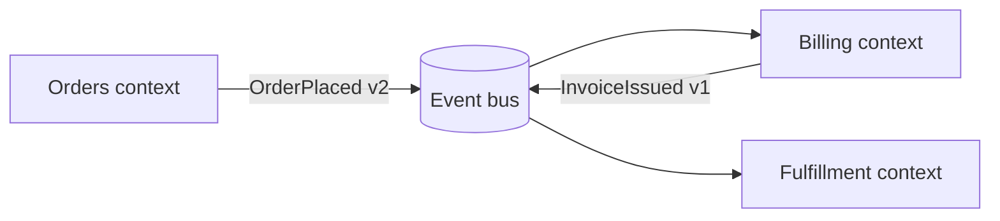

# 04 — Architecture: DDD + Event-Driven

Domain-Driven Design and event-driven architecture aren't just good enterprise practice here — they are **what makes AI agents effective at scale**. Agents thrive on explicit boundaries, named concepts, and contracts they can read. This chapter defines the architectural backbone and how it feeds the agent workflow. The decision to mandate it, and the options rejected, are in [ADR 0005](../docs/adr/0005-ddd-and-event-driven-architecture.md).

## Why this architecture, specifically, for AI-DLC

An agent's competence is bounded by its context. Architecture determines how much context a task needs:

- **Bounded contexts keep tasks inside one agent's working set.** A well-drawn context means a Unit of Work touches one service, one model, one vocabulary — the whole thing fits in a session.
- **Ubiquitous language is shared human-AI vocabulary.** When code, docs, Jira tickets, and conversation all say `SettlementInstruction`, the agent can't confuse it with `Payment`. Naming drift is context poison.
- **Events are contracts agents can read.** A versioned event schema is machine-readable intent. Agents can generate producers, consumers, and tests directly from it.
- **Loose coupling limits blast radius** — of AI mistakes as much as human ones. An agent hallucinating inside one consumer can't corrupt another context's data if the only interface is events.

## The DDD core, operationalized

### Strategic design (do this in Inception)

1. **Event-storm the domain** during extended Mob Elaboration for any new area: domain events on a timeline, then commands, actors, and aggregates. AI participates by proposing events from process descriptions and spotting gaps ("nothing emits `PaymentExpired` — is expiry not a business event?").
2. **Draw the context map.** Name each bounded context, its relationships (customer/supplier, conformist, anti-corruption layer), and its team ownership. One pod can own several contexts; a context never has two owning pods.
3. **Write it down as markdown** in `docs/domain/` — this is the agent's primary domain context:

```text
docs/domain/
├── context-map.md          # Contexts, relationships, owners (Mermaid diagram + table)
└── <context-name>/
    ├── model.md            # Aggregates, entities, value objects, invariants
    ├── language.md         # Glossary: term → precise definition (the ubiquitous language)
    └── events.md           # Events this context publishes/consumes, with schema links
```

Steering files point agents at these docs (`CLAUDE.md`: "before modifying the billing context, read `docs/domain/billing/model.md`"). **A stale domain doc misleads agents at scale — updating it is part of Definition of Done** ([Chapter 02](02-ways-of-working.md)).

### Tactical design (enforce in Construction)

- **Aggregates are consistency boundaries.** State the invariants in `model.md` ("an `Order`'s line-item total must equal its `total`") — agents respect invariants they can read, and reviewers check generated code against them.
- **Value objects over primitives.** `Money`, `AccountId`, `Iban` — the type system becomes steering. Agents (and humans) can't accidentally add euros to dollars if the type forbids it.
- **Repositories and domain services keep persistence out of the domain.** Standard hexagonal/ports-and-adapters layering; put the layering rules in `CLAUDE.md` and enforce with an architecture-test library (ArchUnit for Java, eslint-boundaries or dependency-cruiser for TS, import-linter for Python) so CI catches violations mechanically.

## Event-driven architecture rules



1. **Events are facts, past tense, versioned.** `OrderPlaced`, not `PlaceOrder` (that's a command) and not `OrderUpdated` (that's a diff, not a fact).
2. **Schemas live in a registry** (or a `schemas/` repo) with explicit compatibility rules: additive changes only within a major version; new major version = new event, consumers migrate deliberately. Agents generate producer/consumer code *from the schema*, never freehand.
3. **Consumers are idempotent and tolerant** (must-ignore unknown fields). Make this a steering rule and a test-template — it's exactly the kind of discipline agents apply perfectly once told and forget entirely if not.
4. **Choose the simplest sufficient pattern.** Pub/sub for notification, event-carried state transfer to decouple reads. **Event sourcing and CQRS only where the domain demands it** (audit-heavy aggregates, genuinely divergent read/write shapes). YAGNI applies doubly when generation is cheap — agents will happily build any amount of unneeded machinery you ask for.
5. **Sagas for cross-context processes**, with explicit compensation steps. Document each saga as a Mermaid sequence diagram in the owning context's docs; agents implement compensation reliably when the diagram exists and skip it when it doesn't.

On AWS, the default toolkit is EventBridge (routing), SNS/SQS (fan-out and queues), and Kinesis or MSK where ordering/replay matters; Snowflake-side prototypes use Streams and Tasks as the analogous construct ([Chapter 05](05-rapid-prototyping.md)).

## Frontend and UX under AI-DLC

Everything above is service-side. Agents build user interfaces too, and three things differ. The paved road is a component library, not a module library; the steering rules are about consistency, not invariants; and verification is visual, because nobody can review 400 lines of generated markup for whether it looks right.

- **The design system is the paved road.** A component library with design tokens (colour, spacing, type scale) is to UI work what golden-path IaC modules are to infrastructure: the boundary where consistency and accessibility live. Agents compose components; they do not write ad-hoc styles. Steering line: "Use components from `@org/ui`; no inline styles, no new colour values, no new spacing values. If a component is missing, that is a Unit of Work for the platform pod, not a local workaround."
- **Accessibility is an acceptance criterion, not a review comment.** Every story with a UI surface carries ACs for keyboard navigation, focus order, contrast, and screen-reader labels, in Given/When/Then form like any other AC, so the agent implements and tests them ([Chapter 02](02-ways-of-working.md#testing-under-ai-dlc)). Automated checks (axe in the browser tests) run in CI; they catch the mechanical third and the ACs cover the rest.
- **Verification is visual and behavioural.** The Navigator does not review JSX for whether it is right; they review the screen. The ephemeral environment ([Chapter 07](07-devops-automation.md#the-reference-pipeline-github-actions)) shows the built UI on every PR; browser tests (Playwright) drive the ACs; screenshot diffs against the previous build flag unintended visual change. The agent can take its own screenshots during construction and compare against the design reference before the human looks, which is the fresh-eyes review of UI work.
- **UI state is still domain state.** A screen reads and writes through the bounded context's commands and events, never through a direct database call or a bespoke endpoint that bypasses the domain. Backend-for-frontend layers are thin and stateless. Agents will build a shortcut if the steering does not forbid it.
- **Prototype surfaces are not product surfaces.** Streamlit ([Chapter 05](05-rapid-prototyping.md)) answers questions; a customer-facing product gets the component library, the accessibility ACs, and the visual review. Promotion of a UI prototype is a rebuild, exactly as for any other prototype.

## Architecture decisions: ADRs

Every significant decision gets an [ADR](../standards/adr-template.md) in `docs/adr/`. Under AI-DLC, ADRs do double duty: they inform humans *and* they are steering context — agents read the ADR log before proposing designs, which stops them from relitigating settled decisions or violating them silently. The agent drafts the ADR during the Bolt; humans edit and approve; nothing is "decided" until the ADR is merged.

## How architecture work flows through AI-DLC

| Phase | Architecture activity |
|---|---|
| Inception | Event-storming; context-map updates; AI proposes decompositions and flags cross-context Units of Work (those are the risky ones — split or sequence them) |
| Construction | Agent reads `docs/domain/` + ADRs before planning; plans name the aggregates and events they touch; architecture tests run in CI |
| Operations | Event flows are the observability backbone — trace by correlation ID across contexts ([Chapter 07](07-devops-automation.md)) |

## Anti-patterns

- **The distributed monolith.** Services that share a database or call each other synchronously in chains. Agents make this *worse* faster — they'll cheerfully thread a new synchronous call through six services. The context map and architecture tests are the guardrails.
- **Entity-service architecture** (`UserService`, `OrderService` as CRUD wrappers) instead of behavior-oriented contexts. If your events are all `XUpdated`, you've built CRUD with extra steps.
- **Anemic domain docs.** A `docs/domain/` full of stale diagrams steers agents into walls. Treat doc updates as part of every merge, and let the Friday retro audit one context's docs weekly.
- **Speculative generality.** CQRS, event sourcing, and a rules engine for a form app. Cheap generation makes over-engineering frictionless; the plan gate is where the pod says no.
- **Bespoke UI.** Every screen its own styles and its own fetch calls, because the agent was asked for a screen and nothing constrained it. Symptom: three date pickers. Fix: the component library as steering, and a platform-pod Unit for each missing component.
- **Two vocabularies.** Code says `Client`, product says `Customer`, Jira says `Account`. Pick one in `language.md` and rename ruthlessly — agents amplify whichever inconsistency they see most.

## Tips & tricks

- **Give the agent the invariants, not just the schema.** "Balance never negative; transitions only via `LedgerService`" produces better code than any amount of table DDL.
- **One bounded context per agent session.** Cross-context work = separate sessions per context + an integration session against the event contracts.
- **Generate the boring halves from schemas:** producers, consumers, fixtures, and contract tests from event schemas; this is ideal skill material ([Chapter 03](03-tooling-strategy.md)).
- **Legacy speaks events too:** an anti-corruption layer that translates legacy calls into clean domain events is the bridgehead for modernization — see [Chapter 10](10-legacy-modernization.md).

## References

- Decisions: [ADR 0005 — DDD and event-driven architecture](../docs/adr/0005-ddd-and-event-driven-architecture.md) · [ADR 0011 — Design system as the UI paved road](../docs/adr/0011-design-system-as-ui-paved-road.md)
- Evans, *Domain-Driven Design*; Vernon, *Implementing DDD*; Ford et al., *Building Evolutionary Architectures*
- Previous: [Chapter 03 — Tooling](03-tooling-strategy.md) · Next: [Chapter 05 — Rapid Prototyping](05-rapid-prototyping.md)
