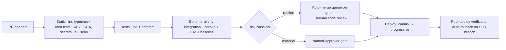

# 07 — DevOps Automation

AI-DLC's Bolt cadence (multiple production deploys per pod per day) is only survivable if the path to production is automated end-to-end, with **risk-based gates** deciding where humans appear. The principle: **automate everything routine; reserve human attention for material changes.**

## The reference pipeline (GitHub Actions)

Stage notes:

- **Static & tests (minutes):** everything from [Chapter 06](06-security-shift-left.md)'s table plus lint/typecheck/architecture tests. Fast and blocking; agents pre-run these locally via hooks so CI failures are rare.
- **Ephemeral environments:** every PR gets a short-lived, production-shaped environment (IaC-provisioned namespace/stack with masked or synthetic data) for integration tests, DAST baseline, and human poking. Destroyed on merge/close. This is the single automation investment with the highest payoff under AI-DLC — it lets reviewers *see* agent-built behavior instead of imagining it.
- **Contract tests over end-to-end tests:** with the event-driven architecture of [Chapter 04](04-architecture.md), producer/consumer contract tests against schema-registry versions replace most cross-service E2E suites. Keep one thin smoke-path E2E; delete the rest as they flake.
- **Post-deploy verification:** synthetic checks + SLO burn-rate watch for N minutes; breach = automatic rollback, no meeting required.

## Risk-based gating

Classify every change; let classification pick the gate. Start conservative, loosen with evidence.

| Class | Examples | Gate |
|---|---|---|
| **Routine** | Code within one bounded context, additive event fields, docs, dependencies (patch/minor via Renovate) | CI green + one human code review → merge queue → auto-deploy |
| **Material** | DB schema migrations, authN/authZ changes, public API or event major-versions, IaC touching network/IAM, new external dependency | Above + named approver (pod lead / security for their domains) + stated rollback plan in PR |
| **Critical** | Data deletion/backfill, crypto, cross-context saga changes, production data access changes | Above + second approver + change window |

Classification is automated (path-based rules + labels the agent applies and a human confirms) — if classification itself is manual, you've moved the bottleneck, not removed it.

## Infrastructure as Code

- **Everything is IaC** — app infra, pipelines, dashboards, alert rules, even the ephemeral-env machinery. If it isn't in git, agents can't see it, reason about it, or safely change it; undocumented console changes are invisible context.
- Standardize on one stack (CDK or Terraform); encode your golden-path patterns as reusable constructs/modules, and steer agents to compose *those* rather than raw resources — the module boundary is where security and cost guardrails live.
- IaC changes are Units of Work like any other: plan gate, review, scan (`checkov`/`tfsec`), and **`terraform plan`/`cdk diff` output pasted into the PR** — reviewers approve the diff of reality, not the diff of code.
- Drift detection runs nightly; drift opens a ticket automatically.

## GitOps and environments

- `main` is always deployable; short-lived branches only; merge queue keeps `main` green.
- Progressive delivery by default: canary or blue/green for services; feature flags decouple deploy from release (agents wire new features behind flags as standard practice — put it in the steering file).
- Environment config is declarative and versioned; promotion between envs is a PR, so the audit trail is git ([Chapter 08](08-github-jira.md) extends this to Jira).

## AI in operations (the third AI-DLC phase)

- **First-line incident investigation:** on alert, an agent correlates logs, traces, recent deploys, and open changes into a hypothesis + evidence bundle before the human even joins. Human confirms and acts; agent drafts the timeline for the post-mortem.
- **Auto-remediation only for pre-approved runbooks** (restart, scale, rollback last deploy) — the runbook is code-reviewed like everything else; anything novel goes through a human.
- **Post-mortems feed steering:** every incident ends with the [Chapter 06](06-security-shift-left.md) question generalized — what steering line, test template, alert, or module change makes this class of incident impossible?
- **Cost is an operational signal:** agents watch for cost anomalies (a favorite failure mode of generated IaC is an oversized default); budgets are alerts, not spreadsheets. Token spend per pod is baselined and alerted the same way — a spend spike usually means an agent looping or a Unit of Work sliced too large, both worth catching same-day ([Chapter 03](03-tooling-strategy.md#unit-economics-cost-per-validated-unit-of-work)).

## Observability requirements

Non-negotiables for AI-built, event-driven systems:

1. **Structured logs with correlation IDs** propagated through every event hop ([Chapter 04](04-architecture.md)) — this is also what makes agent incident-investigation work.
2. **Traces across context boundaries** (OpenTelemetry), **SLOs per service** with burn-rate alerts — alert on symptoms, not causes.
3. **Deploy markers everywhere** so "what changed?" is always answerable — by humans or agents.

## Anti-patterns

- **Human gates on everything** "to be safe." Review capacity is the scarce resource ([Chapter 02](02-ways-of-working.md)); spending it on routine dependency bumps means spending less on the auth change. Uniform caution is risk-*increasing*.
- **Flaky test tolerance.** At Bolt cadence, a 2% flake rate halts the team hourly. Quarantine-and-fix within the week, or delete the test.
- **Snowflake/console exceptionalism.** Warehouse configs, RBAC grants, and Streamlit apps ([Chapter 05](05-rapid-prototyping.md)) are infrastructure — they get IaC and pipelines too (Terraform Snowflake provider / schemachange).
- **Rollback as an aspiration.** If rollback isn't a tested, one-command (or automatic) path, you don't have one. Test it monthly.
- **The staging queue.** A shared staging env with a sign-up sheet recreates the sprint. Ephemeral envs exist precisely to kill this.

## Tips & tricks

- **Agents fix their own CI failures:** a failing check posts logs to the PR; the driver feeds them straight back into the session. Tight loop, no context switch.
- **Pipeline-as-steering:** keep a `docs/pipeline.md` the agent reads so generated code anticipates the gates (runs the same linters, generates contract tests) instead of discovering them in CI.
- **Renovate + auto-merge for patch/minor deps** with the routine gate; agents handle major-version migration PRs as micro-Units of Work.
- **Measure DORA plus review-latency.** Deploy frequency, lead time, change-failure rate, MTTR — and time-from-PR-to-first-human-review, which is the AI-DLC-specific bottleneck to watch.

## References

- [DORA research](https://dora.dev) · [OpenTelemetry](https://opentelemetry.io) · Accelerate (Forsgren, Humble, Kim)
- Previous: [Chapter 06 — Security](06-security-shift-left.md) · Next: [Chapter 08 — GitHub + Jira](08-github-jira.md)
