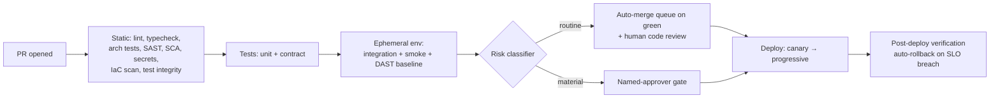

# 07 — DevOps Automation

AI-DLC's Bolt cadence (multiple production deploys per pod per day) is only survivable if the path to production is automated end-to-end, with **risk-based gates** deciding where humans appear. The principle: **automate everything routine; reserve human attention for material changes.**

## The reference pipeline (GitHub Actions)

Stage notes:

- **Static & tests (minutes):** everything from [Chapter 06](06-security-shift-left.md)'s table plus lint/typecheck/architecture tests. Fast and blocking; agents pre-run these locally via hooks so CI failures are rare.
- **Ephemeral environments:** every PR gets a short-lived, production-shaped environment (IaC-provisioned namespace/stack with masked or synthetic data) for integration tests, DAST baseline, and human poking. Destroyed on merge/close. This is the single automation investment with the highest payoff under AI-DLC — it lets reviewers *see* agent-built behavior instead of imagining it. For UI work this is the review: screenshots and browser-driven acceptance tests against the ephemeral environment, with visual diffs against the previous build ([Chapter 04](04-architecture.md#frontend-and-ux-under-ai-dlc)).
- **Mutation testing on the diff:** after unit tests, mutate the changed files and require the suite to catch the faults (thresholds and tooling in the [test review checklist](../standards/test-review-checklist.md)). Whole-codebase mutation runs are too slow; diff-scoped runs take minutes and are the one check that measures whether generated tests detect anything.
- **Test integrity:** fails a PR that modifies or deletes a test present on the base branch, or adds a skip or expected-failure marker, unless a person applied the `test-change-approved` label with a reason in the PR. It runs with the static checks, because it reads only the diff ([test review checklist](../standards/test-review-checklist.md#the-mechanical-checks)).
- **Non-functional checks, sized to the gate:** every PR's ephemeral environment runs a short performance smoke against the latency and throughput budgets stated as ACs ([Chapter 02](02-ways-of-working.md#testing-under-ai-dlc)), failing on a regression beyond the budget, not on noise. Full load tests and resilience runs (dependency timeouts, a killed instance, a slow consumer) are too slow for every PR; they run nightly against `main` and on every PR in the material and critical classes. Accessibility checks run with the browser tests.
- **Contract tests over end-to-end tests:** with the event-driven architecture of [Chapter 04](04-architecture.md), producer/consumer contract tests against schema-registry versions replace most cross-service E2E suites. Keep one thin smoke-path E2E; delete the rest as they flake.
- **Post-deploy verification:** synthetic checks + SLO burn-rate watch for N minutes; breach = automatic rollback, no meeting required.

## Risk-based gating

Classify every change; let classification pick the gate. Start conservative, loosen with evidence.

| Class | Examples | Gate |
|---|---|---|
| **Routine** | Code within one bounded context, additive event fields, docs, dependencies (patch/minor via Renovate) | CI green + one human code review → merge queue → auto-deploy |
| **Material** | DB schema migrations, authN/authZ changes, public API or event major-versions, IaC touching network/IAM, new external dependency | Above + named approver (pod lead / security for their domains) + stated rollback plan in PR |
| **Critical** | Data deletion/backfill, crypto, cross-context saga changes, production data access changes | Above + second approver + change window |

Classification is automated (path-based rules + labels the agent applies and a human confirms) — if classification itself is manual, you've moved the bottleneck, not removed it.

## Infrastructure as Code

- **Everything is IaC** — app infra, pipelines, dashboards, alert rules, even the ephemeral-env machinery. If it isn't in git, agents can't see it, reason about it, or safely change it; undocumented console changes are invisible context.
- Standardize on one stack (CDK or Terraform); encode your golden-path patterns as reusable constructs/modules, and steer agents to compose *those* rather than raw resources — the module boundary is where security and cost guardrails live.
- IaC changes are Units of Work like any other: plan gate, review, scan (`checkov`/`tfsec`), and **`terraform plan`/`cdk diff` output pasted into the PR** — reviewers approve the diff of reality, not the diff of code.
- Drift detection runs nightly; drift opens a ticket automatically.

## Data and schema migrations

Code rolls back in a minute; data does not roll back at all. Migrations are already material and backfills critical in the [gating table](#risk-based-gating), and the Bolt plan's stop conditions halt the agent when a schema change appears ([Bolt plan template](../standards/bolt-plan-template.md)). What those controls do not say is what a *good* agent-written migration looks like. Agents write migrations that are correct on an empty database and lock a production table for twenty minutes, so the rules go in the steering file and are checked in the pipeline:

- **Expand, then contract, in separate deploys.** Add the new column or table; deploy code that writes both and reads the new; backfill; deploy code that reads only the new; drop the old in a later Unit. Every step is backward-compatible with the code running beside it, which is what lets canary and rollback keep working. A single migration that renames or drops something in use is a stop condition, not a plan.
- **Never edit an applied migration.** A migration that has run anywhere shared is history; fixes are new migrations. Hooks block edits to applied migration files, as they already protect `migrations/` ([Chapter 06](06-security-shift-left.md#securing-the-agents-themselves)).
- **Reversible, or a written forward fix.** Each migration ships its down step, or the PR states why it cannot be reversed and what the forward fix is. "Restore from backup" is not a rollback plan for a single change.
- **Rehearse on production-shaped data.** The ephemeral environment runs the migration against a masked snapshot at production scale, and the PR carries the timing and the locks taken. A migration that takes a table-level lock on a hot table, or runs longer than the deploy window, is redesigned before review.
- **Backfills are jobs, not migrations.** Idempotent, batched, resumable, throttled, and observable, run by the deploy pipeline as their own critical-class change. A backfill inside a schema migration turns a slow deploy into an outage.
- **Event schemas follow the same idea.** Additive fields within a version; a new major version is a new event that consumers move to deliberately ([Chapter 04](04-architecture.md#event-driven-architecture-rules)).

## GitOps and environments

- `main` is always deployable; short-lived branches only; merge queue keeps `main` green.
- Progressive delivery by default: canary or blue/green for services; feature flags decouple deploy from release (agents wire new features behind flags as standard practice — put it in the steering file).
- Environment config is declarative and versioned; promotion between envs is a PR, so the audit trail is git ([Chapter 08](08-github-jira.md) extends this to Jira).

## AI in operations (the third AI-DLC phase)

- **First-line incident investigation:** on alert, an agent correlates logs, traces, recent deploys, and open changes into a hypothesis + evidence bundle before the human even joins. Human confirms and acts; agent drafts the timeline for the post-mortem. Packaged as the [`incident-investigate` skill](../standards/skills/incident-investigate/SKILL.md), which is read-only by rule.
- **Auto-remediation only for pre-approved runbooks** (restart, scale, rollback last deploy) — the runbook is code-reviewed like everything else; anything novel goes through a human.
- **Post-mortems feed steering:** every incident ends with the [Chapter 06](06-security-shift-left.md) question generalized — what steering line, test template, alert, or module change makes this class of incident impossible? The [`lesson-to-steering` skill](../standards/skills/lesson-to-steering/SKILL.md) turns the answer into a draft PR; the [post-incident review template](../standards/post-incident-review-template.md) is where the question is asked.
- **Cost is an operational signal:** agents watch for cost anomalies (a favorite failure mode of generated IaC is an oversized default); budgets are alerts, not spreadsheets. Token spend per pod is baselined and alerted the same way — a spend spike usually means an agent looping or a Unit of Work sliced too large, both worth catching same-day ([Chapter 03](03-tooling-strategy.md#unit-economics-cost-per-validated-unit-of-work)).

## Observability requirements

Non-negotiables for AI-built, event-driven systems:

1. **Structured logs with correlation IDs** propagated through every event hop ([Chapter 04](04-architecture.md)) — this is also what makes agent incident-investigation work.
2. **Traces across context boundaries** (OpenTelemetry), **SLOs per service** with burn-rate alerts — alert on symptoms, not causes.
3. **Deploy markers everywhere** so "what changed?" is always answerable — by humans or agents.
4. **The agents are instrumented too.** The coding agent's sessions (tokens, cost, tool calls) and every model call an AI feature makes ([Chapter 13](13-building-ai-features.md#operating-ai-features)) flow through the same OpenTelemetry pipeline, tagged with the pod and the Unit of Work key, so cost per Unit ([Chapter 03](03-tooling-strategy.md#unit-economics-cost-per-validated-unit-of-work)) and incident investigation read one system.

OpenTelemetry is the contract; the backend is configuration. The current backend, its access model, and the facts that go stale live in the [observability stack reference](../standards/observability-stack.md) ([ADR 0027](../docs/adr/0027-opentelemetry-contract-and-cloudwatch-omni-default-backend.md)).

## Anti-patterns

- **Human gates on everything** "to be safe." Review capacity is the scarce resource ([Chapter 02](02-ways-of-working.md)); spending it on routine dependency bumps means spending less on the auth change. Uniform caution is risk-*increasing*.
- **Flaky test tolerance.** At Bolt cadence, a 2% flake rate halts the team hourly. Quarantine-and-fix within the week, or delete the test.
- **Snowflake/console exceptionalism.** Warehouse configs, RBAC grants, and Streamlit apps ([Chapter 05](05-rapid-prototyping.md)) are infrastructure — they get IaC and pipelines too (Terraform Snowflake provider / schemachange).
- **The one-step rename.** An agent asked to rename a column writes one migration that renames it, and the old code still running on half the fleet fails on its next query. Expand, deploy, backfill, contract; four steps is the price of zero downtime.
- **Rollback as an aspiration.** If rollback isn't a tested, one-command (or automatic) path, you don't have one. Test it monthly.
- **The staging queue.** A shared staging env with a sign-up sheet recreates the sprint. Ephemeral envs exist precisely to kill this.

## Tips & tricks

- **Agents fix their own CI failures:** a failing check posts logs to the PR; the driver feeds them straight back into the session. Tight loop, no context switch.
- **Pipeline-as-steering:** keep a `docs/pipeline.md` the agent reads so generated code anticipates the gates (runs the same linters, generates contract tests) instead of discovering them in CI.
- **Renovate + auto-merge for patch/minor deps** with the routine gate; agents handle major-version migration PRs as micro-Units of Work.
- **Measure DORA plus review-latency.** Deploy frequency, lead time, change-failure rate, MTTR — and time-from-PR-to-first-human-review, which is the AI-DLC-specific bottleneck to watch.

## References

- Decisions: [ADR 0013 — NFRs as acceptance criteria](../docs/adr/0013-non-functional-requirements-as-acceptance-criteria.md) · [ADR 0015 — Expand/contract migrations](../docs/adr/0015-expand-contract-migrations.md) · [ADR 0022 — Tests first, with a test-integrity check](../docs/adr/0022-tests-first-with-a-test-integrity-check.md) · [ADR 0027 — OpenTelemetry contract, CloudWatch Omni default](../docs/adr/0027-opentelemetry-contract-and-cloudwatch-omni-default-backend.md)
- [DORA research](https://dora.dev) · [OpenTelemetry](https://opentelemetry.io) · Accelerate (Forsgren, Humble, Kim)
- Previous: [Chapter 06 — Security](06-security-shift-left.md) · Next: [Chapter 08 — GitHub + Jira](08-github-jira.md)
