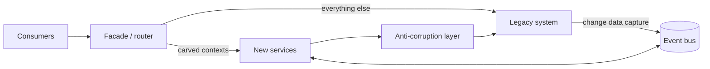

# 10 — Legacy Modernization: COBOL & Java

Legacy modernization is where AI-DLC pays for itself fastest — because the historically expensive steps (reading a million lines of COBOL, documenting what it actually does, upgrading a decade of Java) are precisely what agents are good at. This chapter gives the operating model: **comprehend → carve → transform → strangle**, run as ordinary Units of Work.

The one law of this chapter: **the legacy system is the specification.** Decades of undocumented fixes *are* the business rules, including the ones nobody remembers deciding. Modernization that starts by rewriting from tribal memory ships regressions; modernization that starts by extracting what the code really does can be verified.

## Stage 1: Comprehend (AI's home turf)

Turn opaque code into markdown the whole method can consume:

- **Automated codebase archaeology:** agents map programs, copybooks, JCL, DB2/VSAM access, screens, and call graphs — or the Java equivalent (modules, beans, stored-proc calls, batch jobs). AWS Transform's analysis/documentation agents do this at mainframe scale; Claude Code does it per-repo for Java.
- **Output is `docs/legacy/<system>/`:** system overview, per-program summaries, data dictionary, interface inventory, and a **business-rules extract** — each rule with a pointer to the code that implements it (`RULE: late-payment fee waived for accounts > 20 years old — PAYPROC.cbl ¶ 2200-FEE-CALC`). Rules whose *reason* nobody can name get flagged, not deleted — Chesterton's fence, mechanized.
- **This corpus is agent context for everything downstream** — and a Docling/DocLang conversion pilot target where legacy docs exist only as scanned PDFs ([Chapter 09](09-documentation-standards.md)).
- Humans (including the last COBOL veterans — book their calendar now, this is their highest-value work) review the extracts for the subset of rules that are load-bearing.

## Stage 2: Carve (DDD applied to the past)

The comprehension corpus feeds event-storming and context-mapping exactly as in [Chapter 04](04-architecture.md), with agents proposing bounded contexts from observed data-flow and transaction clusters — AWS Transform calls this domain decomposition; do the same for Java monoliths with Claude Code against the analysis docs.

Rules of the carve:

- **Contexts are carved along business capability, not program structure.** A 40-year-old batch job often contains three capabilities; two programs often share one.
- **Prioritize by (business change-rate × operational pain), not by size.** The context product wants to change monthly but can't is first; the stable actuarial core may reasonably run on the mainframe for years more. "Modernize everything" is not a strategy; it's a budget.
- **Each carved context gets a modernization disposition:** rewrite into a modern service, transform mechanically (Stage 3), wrap-and-retain, or retire. Record each as an [ADR](../standards/adr-template.md).

## Stage 3: Transform (tool-assisted, verification-led)

Two distinct playbooks:

**COBOL → Java/cloud:** [AWS Transform for mainframe](https://aws.amazon.com/transform/mainframe/) (GA since May 2025) runs agentic analysis→decomposition→wave-planning→refactoring of z/OS COBOL into Java. Treat its output like any agent's output under AI-DLC: **generated is not done** — transformed code enters normal Bolts for review, test-hardening, and alignment with your architecture standards. Budget real effort for the parts transforms don't solve: data migration (EBCDIC, packed decimals, VSAM→relational), JCL orchestration (→ Step Functions/Airflow), and batch-window semantics in a streaming world.

**Legacy Java → modern Java:** the quieter, larger win. Agents (AWS Transform custom / Q Developer for bulk version upgrades; Claude Code for per-repo work) handle Java 8→21 upgrades, framework migrations (Struts/EJB → Spring Boot), dependency CVE burn-down, and test-coverage backfill. Run as routine Units of Work at a steady cadence — a "modernization tax" of one Bolt per pod per week retires astonishing amounts of debt in a year.

**Verification is the actual product:**

- **Characterization tests first** (Golden Master): capture current behavior — including the weird parts — as tests *before* transforming; agents generate these en masse from the Stage-1 rules extract. The old system is the oracle.
- **Parallel run** for anything financial or compliance-relevant: old and new compute side-by-side on production inputs; diff the outputs until divergence is zero-or-explained for an agreed period. Non-negotiable for money paths.
- Every discrepancy is a discovered business rule → back into the Stage-1 corpus.

## Stage 4: Strangle (the delivery pattern)

Cut over incrementally with the [strangler fig](https://martinfowler.com/bliki/StranglerFigApplication.html) pattern, using the event backbone from [Chapter 04](04-architecture.md):

- A **facade** routes each capability to old or new; cutover per capability, rollback = a routing change.
- **Event interception / CDC** publishes legacy state changes as domain events, letting new services (and [Snowflake analytics](05-rapid-prototyping.md)) consume legacy data without touching legacy code.
- An **anti-corruption layer** keeps legacy models from leaking into new contexts — the ACL speaks the new ubiquitous language outward and legacy-ese inward.
- The mainframe shrinks capability by capability until what remains is retired — or is small, stable, and cheap enough to keep deliberately.

## Anti-patterns

- **Big-bang rewrite.** Multi-year, all-at-once replacement fails at the same rate it always has; AI makes the code cheaper but not the risk. Strangle instead.
- **Transpile-and-declare-victory.** Mechanically converted "JOBOL" (COBOL idioms in Java syntax) without Bolt-hardening becomes new legacy on day one, now with no veterans who understand *either* form.
- **Modernizing without the comprehension corpus.** Skipping Stage 1 because "we're rewriting anyway" — you can't verify what you never captured, and you'll rediscover the missing rules in production, one incident at a time.
- **Trusting the transform's tests.** Tests generated *from the new code* prove the new code agrees with itself. Characterization tests come from the *old* behavior.
- **Letting dispositions rot.** A wrap-and-retain decision from 2026 deserves re-evaluation when the change-rate shifts; re-read the ADRs yearly.

## Tips & tricks

- **Feed Stage-1 outputs into elaboration:** Mob Elaboration for a modernization Unit opens with the agent summarizing the relevant program docs and rules — veterans then correct, which is a far better use of scarce experts than having them explain from scratch.
- **Interview the veterans, transcribe, convert to markdown, index it.** Their heads are the only copy of the "why" behind flagged rules; this corpus outlives their retirement.
- **Start the parallel-run harness before the first transform** — it takes longer to build than anyone budgets and everything downstream queues behind it.
- **Use modernization as AI-DLC training:** characterization-test generation and Java upgrades are low-ambiguity, high-verification work — ideal first Bolts for pods new to the method ([Chapter 11](11-learning-paths.md)).

## References

- [AWS Transform for mainframe](https://aws.amazon.com/transform/mainframe/) · [Amazon Q Developer: Transform](https://aws.amazon.com/q/developer/transform/) · [AWS mainframe modernization guide (2026)](https://repost.aws/articles/ARue7jnmK4RUSaQH0NkZ4wng/mainframe-modernization-with-aws-a-complete-guide-for-2026)
- Feathers, *Working Effectively with Legacy Code*; Fowler, [Strangler Fig](https://martinfowler.com/bliki/StranglerFigApplication.html)
- Previous: [Chapter 09 — Documentation](09-documentation-standards.md) · Next: [Chapter 11 — Learning Paths](11-learning-paths.md)
