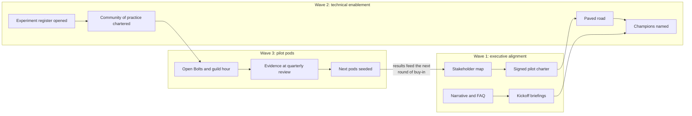
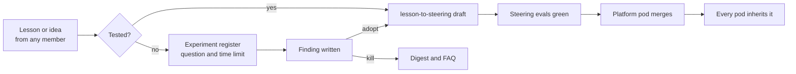

# 12 — Adoption Strategy: Innovation, Buy-in, and Community

This chapter is for the people who have to make AI-DLC happen in an organization that did not ask for it: engineering leaders, the champions who carry it into their teams, and whoever coordinates the community of practice. It covers the parts of adoption that are about people, not the method: making room to innovate, getting stakeholders to buy in, explaining the ideas to the wider team, and building a community that keeps going after launch. The rollout sequence (three waves) and the role-based learning paths are in [Chapter 11](11-learning-paths.md#the-enablement-program-three-waves); this chapter runs alongside them.

The thesis in one line: **adoption is earned with evidence and kept alive by a community, not declared by a mandate.** A mandate gets you licenses and compliance. Evidence and community get people to change how they work.

## The strategy on a page

Five workstreams run in parallel across the three waves. Each has an owner, an artifact in git, and a signal that says whether it is working.

| Workstream | Goal | Owner | Artifact | Working when |
|---|---|---|---|---|
| **Innovate** | A steady, cheap flow of experiments that feed the paved road | Community of practice coordinator | [Experiment register](#the-experiment-register) | Experiments reach a kill, keep, or adopt decision every month |
| **Adopt** | Pods running AI-DLC on real work, growing by seeding | Engineering leader (sponsor) | [Pilot charter](../standards/pilot-charter-template.md) | Pilot success criteria met; next-quarter pods named |
| **Socialize** | The wider team understands the ideas before they are asked to use them | Champions network | [Communication plan](#socializing-the-ideas) | Questions move from "what is a Bolt?" to "when does my team get one?" |
| **Buy in** | Stakeholders commit budget, scope, and political cover | Executive sponsor | [Stakeholder map](#the-stakeholder-map) | Each key stakeholder has seen the evidence they asked for and signed the charter |
| **Community** | Practitioners teach each other and improve the practice without a central team | Community of practice | [Community charter](../standards/community-of-practice-charter-template.md) | Most steering changes come from outside the platform pod |

The loop at the end matters most. Each quarter's evidence is what buys the next quarter's scope. Buy-in is never finished; it is renewed with results.

## Innovating deliberately

Innovation under AI-DLC is not a hackathon every now and then. It is a small, steady flow of experiments with written questions, time limits, and a decision at the end, run with the same rigor as a [prototype](05-rapid-prototyping.md). The model moves fast (new models, new agent features, new MCP servers every month), so the question is not whether to experiment. The question is how to experiment without every team trying things on its own and none of it being shared.

### Three horizons, one budget

Split experimentation capacity across three horizons so that today's delivery pays for tomorrow's options:

- **Adopt (about 70%).** Improvements to how existing pods work: a new skill, a tighter hook, a better Mob Elaboration prompt. Low risk, compounds quickly, lands as a steering PR.
- **Pilot (about 20%).** A practice or tool one pod tries for a quarter before anyone else does: a second agent for a specific task, [ephemeral environments](07-devops-automation.md) for a new stack, agent-first incident triage. Lands as an ADR, then as paved road.
- **Explore (about 10%).** Ideas that may not work at all: agents in elaboration without a human facilitator, spec-driven IDEs, new modernization tooling. Lands as a written finding, whatever the result.

These percentages are a starting point for the pilot quarter, not a law. What matters is that exploration has a budget someone defends. Without one, delivery pressure pushes it to zero within a month.

### The experiment register

One markdown file, `docs/experiments/register.md` in the steering repo, one row per experiment:

| Field | Rule |
|---|---|
| Question | Written before anything is built, as in [Chapter 05](05-rapid-prototyping.md#prototyping-principles). No question, no experiment. |
| Horizon | Adopt, pilot, or explore |
| Owner and pod | A named person; experiments without owners are abandoned by default |
| Time limit | At most three Bolts for adopt and explore; one quarter for pilot |
| Evidence required | What result would change the paved road, stated before the experiment starts |
| Decision | Kill, keep local, or adopt org-wide, with a link to the finding, ADR, or steering PR |

Kills are published with the same prominence as wins. A killed experiment with a clear write-up saves every other pod the same week of effort, and a community that only reports successes teaches people to hide failures.

### From experiment to paved road

An experiment that earns adoption follows the normal governance path, not a special one: finding written up, ADR drafted if it changes a recommendation, steering or skill PR through [`lesson-to-steering`](../standards/skills/lesson-to-steering/SKILL.md), [steering evals](../standards/steering-evals.md) green, platform pod merges ([Chapter 02](02-ways-of-working.md#scaling-beyond-one-pod)). Innovation that skips this path turns into tool sprawl ([Chapter 03](03-tooling-strategy.md#anti-patterns)).

## Earning stakeholder buy-in

Stakeholders do not buy into a methodology. They buy into an outcome they care about, with a risk they can live with, backed by evidence they believe. The work is to find out, for each stakeholder, what those three things are, and then to produce that evidence in the order that unblocks the program.

### The stakeholder map

Build the map in Wave 1, before the pilot charter is drafted, and keep it in the charter's repo. The table below is the typical starting cast; add or remove rows to match your organization.

| Stakeholder | What they care about | What they worry about | Evidence that moves them | What we ask of them |
|---|---|---|---|---|
| **Executive sponsor** | Lead time, competitive speed, cost of delivery | A visible failure with their name on it | Baseline plus a credible pilot scope with a low blast radius | Budget, political cover, a quarterly review slot |
| **Finance** | Predictable spend, unit economics | Token spend without limits | [Cost per validated Unit of Work](03-tooling-strategy.md#unit-economics-cost-per-validated-unit-of-work) showback and the daily anomaly alert | A token budget managed like cloud spend |
| **Security and risk** | Data leaving the perimeter, new attack surface, audit | Agents with production credentials; prompt injection | [Vendor governance](03-tooling-strategy.md#vendor-governance) ADRs; [agent security controls](06-security-shift-left.md#securing-the-agents-themselves); traceability chain | A named security engineer in the pilot |
| **Architecture** | Coherence, long-term maintainability | Fast-generated code nobody understands | ADR log; [DDD boundaries](04-architecture.md); review depth metric | Ownership of the context map |
| **Engineering managers** | Delivery commitments, their people's careers | Losing headcount; losing control of the plan | Pod shape and rhythm ([Chapter 02](02-ways-of-working.md)); learning paths with practica | Release two to three people for a quarter |
| **Product owners** | Getting the right thing built sooner | More meetings; losing the backlog as their tool | An observed Mob Elaboration that ends with approved Units | Half a day each Monday |
| **Developers** | Craft, autonomy, not being replaced | Becoming reviewers of slop; deskilling | An open Bolt from a respected peer; the review disciplines | Honest participation, including objections |
| **Program management office (PMO) and delivery** | Portfolio reporting, predictability | Sprints and velocity disappearing | The [reporting shell](../docs/adr/0004-bolts-as-labels-not-sprints.md) and lead-time dashboards | Accepting Units of Work and lead time as the reporting currency |
| **People and HR, works council where present** | Role changes, fairness, consultation duties | Performance measured by AI usage | The rule that [no metric targets individuals](../standards/metrics-reference.md) | Early consultation, not late notification |

Two rules make the map useful rather than decorative. First, **every row has a named person and an owner on the adoption side**, so "security is on board" means someone talked to a specific person and wrote down what they said. Second, **update the "worried about" column after every conversation**. The concern people actually raise in the second meeting is rarely the one assumed in the first.

### The buy-in ladder

Commitment builds in stages, and trying to jump a stage costs more than it saves. Track each key stakeholder's position on the map:

1. **Aware.** Has heard the narrative and knows a pilot is proposed.
2. **Understands.** Can explain what changes for their area in their own words.
3. **Has seen it.** Has watched a real Bolt or Mob Elaboration, not a slide about one.
4. **Committed.** Has signed the pilot charter or put resources into it.
5. **Advocate.** Argues for the next wave to their own peers without being asked.

The move from 2 to 3 is where most programs stall, and the remedy is almost always the same: invite them to an [open Bolt](#socializing-the-ideas). Seeing a pod work for an hour answers more objections than any briefing.

### Handling the hard objections

Answer these in writing, once, in a FAQ held in the steering repo ([FAQ template](../standards/faq-template.md)), and link to it rather than re-arguing each time.

- **"Is this about cutting headcount?"** Say what the program actually intends and what it does not, and get the sponsor to say it too. If the organization has not decided, say that. A vague reassurance that later proves false ends trust in the program for good.
- **"AI code is lower quality."** Agree that unreviewed AI code is. Then show the gates ([Chapter 01](01-ai-dlc-methodology.md#the-validation-gates)), the review depth metric, and the pilot's escaped-defect numbers against its baseline.
- **"We tried Copilot and got 10%."** That result is expected: it is the "AI-assisted Scrum" anti-pattern. The claim to test is that the process change, not the tool, produces the gain.
- **"Our domain is too regulated or too legacy."** Invite them to name the hardest real example, then run it through a Bolt in public ([Chapter 11](11-learning-paths.md#anti-patterns)). [Chapter 10](10-legacy-modernization.md) is often the best first pilot for exactly these teams.
- **"What if the vendor changes terms or disappears?"** Point to the written degraded mode and the annual review in [vendor governance](03-tooling-strategy.md#vendor-governance). Steering is markdown and moves with you.

### The pilot charter is the contract

Wave 1 ends with a signed [pilot charter](../standards/pilot-charter-template.md): pods, scope, success criteria, the [baseline](../standards/metrics-reference.md#the-pilot-baseline), budget, guardrails, and the date of the review. Its value is that it turns buy-in into something checkable. At the end of the quarter the sponsor reads results against criteria everyone agreed to before the pilot started, not against whatever story is being told that week.

## Socializing the ideas

The wider team needs to understand AI-DLC well before they are asked to adopt it, and much earlier than feels necessary. People who first hear the vocabulary on the day their team is reorganized into pods will resist it, however good the method is.

### One narrative, told consistently

Write a single, one-paragraph narrative in plain language and have the sponsor, the champions, and this playbook all use it. A starting draft to adapt:

> We are changing how we build software, not just adding a tool. Small pods of two or three people work with AI agents that draft plans, code, and tests, while people make every decision that matters at explicit review points. We are starting with a small pilot on real work, measuring it against how we deliver today, and sharing everything we learn, including what does not work. Nobody is being asked to trust this on faith; you will be able to watch it and judge for yourself.

Use the [glossary](../GLOSSARY.md) terms from the first conversation. Mixing "sprint" and "Bolt", or "squad" and "pod", in early messaging produces two half-understood vocabularies that take a year to untangle.

### Show, don't tell: the channels that work

Ranked roughly by how much understanding each produces per hour spent:

| Channel | Format | Cadence | Audience |
|---|---|---|---|
| **Open Bolt** | Anyone may silently observe a pilot pod's Mob Construction for an hour, then ask questions for fifteen minutes | Weekly slot per pilot pod | Anyone curious, especially skeptics and stakeholders at the "understands" rung |
| **Guild hour** | One pod demos a real Bolt, failures included ([Chapter 11](11-learning-paths.md#the-knowledge-system-how-learning-compounds)) | Biweekly | Practitioners and the curious |
| **Office hours** | Champions available to help anyone try a technique on their own repo | Weekly | Developers outside the pilot |
| **Monthly digest** | The markdown "what we learned" digest from pod journals | Monthly | Whole engineering organization |
| **Leadership update** | One page: metrics against the charter, decisions needed, the next risk | Monthly | Sponsor and stakeholder map |
| **All-hands slot** | Ten minutes, one pod member (not the sponsor) tells one real story with one number | Quarterly | Everyone |
| **Brown-bag intros** | "AI-DLC in 30 minutes": the vocabulary, the gates, a recorded Bolt clip | On demand, per department | Teams about to be seeded; adjacent functions |

Polished presentations come last on purpose. They are the easiest to produce and the least believed. A recorded clip of an agent going wrong and a Navigator catching it is more convincing than any demo where everything works.

### Sequencing messages by wave

- **Wave 1:** narrative, FAQ, and briefings for the stakeholder map. The broader team hears that a pilot is coming, why, and how they will be able to watch it. Nothing is presented as decided that is not.
- **Wave 2:** champions named and introduced; brown bags start for the departments the pilot touches; the experiment register opens so people can contribute before the pilot does.
- **Wave 3:** open Bolts, guild hour, digest, and the monthly leadership update. Results are shared as they come in, including bad weeks.
- **Next quarter:** the quarterly review's outcome is shared in full, and the teams to be seeded next hear it from the practitioners who will anchor their new pods.

## The community of practice

A **community of practice** is the voluntary, cross-team network of people who practice AI-DLC and improve it together. It owns the *practice*: the craft knowledge, the experiments, and the social fabric that lets a skeptic ask a peer a naive question. It does not own the *platform*: the [platform pod](02-ways-of-working.md#scaling-beyond-one-pod) owns the paved road and merges steering changes. And it is not a Center of Excellence: it does not approve anyone's work, and it has no gate.

That distinction is the main design decision. Central teams that own both the standard and the approval become bottlenecks within two quarters, and teams route around them. A community that owns the conversation and contributes through normal PRs scales with the number of practitioners instead.

### Roles

| Role | Who | Commitment | Responsibilities |
|---|---|---|---|
| **Sponsor** | An engineering leader from the stakeholder map | One hour a month | Protects the time budget; removes blockers; hears the quarterly report |
| **Coordinator** | A practitioner, rotated every two quarters | About 10% of their time | Runs the calendar, keeps the experiment register honest, publishes the digest rota |
| **Champion** | One per team or department, including teams not yet seeded | About 5% of their time | Office hours; local translation of the narrative; brings their team's questions and objections back to the community |
| **Member** | Anyone who wants to be | As they choose | Attends, asks, contributes lessons and experiments |

Champions from teams that have *not* adopted AI-DLC yet are the most valuable and the hardest to recruit. They carry the ideas into places where no pilot pod exists, and they bring back the objections the program most needs to hear.

### Rituals and artifacts

The community reuses what the playbook already defines rather than inventing parallel machinery:

- **Guild hour** (biweekly) and the **monthly digest** are its core rituals; [Chapter 11](11-learning-paths.md#the-knowledge-system-how-learning-compounds) defines both.
- **Open Bolts and office hours** are its outreach, as above.
- **Innovation day** (quarterly): one day where members run explore-horizon experiments from the register in mixed pods. Each ends with a written finding, not a demo alone.
- **Retrospective on the community itself** (quarterly, 45 minutes): what drew people in, what drove them away, what to stop.
- **Artifacts are markdown in git** ([Chapter 09](09-documentation-standards.md)): the community charter, the experiment register, the FAQ, and the digests all live in the steering repo, so an agent can answer "has anyone tried X?" from them.
- **One chat channel** for questions, with a norm that any answer given twice becomes a FAQ entry or a steering PR.

### How contribution flows

A member's lesson should reach every pod in about a week, through the same path a pod's lessons use:

### Growing and sustaining the community

Communities of practice follow a predictable lifecycle; plan for each stage rather than being surprised by it.

1. **Seed (Wave 2).** The pilot pod members, the platform pod, and four to six champions. Charter written. Membership is invited, not announced.
2. **Grow (Wave 3 and the first seeded quarter).** Open Bolts and office hours pull in the curious. Measure attendance from outside the pilot, not total attendance.
3. **Sustain (year one onward).** The coordinator role rotates; most contributions come from outside the platform pod; the sponsor changes without the community noticing. This is the stage that proves it was a community and not a project.
4. **Renew or retire.** When AI-DLC is simply how the organization works, the community may merge into a broader engineering practice forum. Deciding that on purpose is a success, not a failure.

Health is measured with the adoption metrics in the [metrics reference](../standards/metrics-reference.md#adoption-and-community), never by counting members or messages.

## The first 90 days

A concrete sequence for a leader starting from nothing, mapped to the waves in [Chapter 11](11-learning-paths.md#the-enablement-program-three-waves):

| Weeks | Do | Artifact produced |
|---|---|---|
| 1–2 | Name the sponsor. Draft the narrative and FAQ. Start the stakeholder map with named people. | Narrative, FAQ, map v1 |
| 3–4 | One-to-one conversations with every row of the map. Capture the pilot baseline. Pick the pilot scope. | Map v2 with real concerns; baseline |
| 5–6 | Draft and circulate the pilot charter. Recruit champions and the first coordinator. | Charter signed; champion list |
| 5–10 | Wave 2 builds the paved road. Write the community charter; open the experiment register. First brown bags. | Community charter; register |
| 11–13 | Pilot pods start. Open Bolts and guild hour begin. First monthly leadership update. | First digest; first update |

The pilot quarter then runs its course, and the quarterly review against the charter restarts the loop with the next round of buy-in.

## Anti-patterns

- **Adoption by memo.** A leadership announcement that "we are now an AI-first engineering organization", with licenses and no pilot, charter, or community. Usage metrics climb; delivery metrics do not.
- **The Center of Excellence gate.** A central team that must approve every pod's steering, tools, or experiments. It becomes the bottleneck, then the enemy, then routed around.
- **Selling the tool instead of the outcome.** Stakeholders asked to buy "Claude Code" or "agents" rather than lead time, quality, and a controlled risk. When the tool changes, the buy-in goes with it.
- **The champion who was volunteered.** Champions appointed by their manager without interest, or without the time budget. They go through the motions and quietly signal to their team that nobody means it.
- **Hiding the bad weeks.** Digests and updates that only report wins. The first failure that leaks out, and one will, discredits everything reported before it. [Appendix C](appendix-c-a-bolt-that-fails.md) shows a failed Bolt written up for guild hour.
- **Innovation without a register.** Individuals trying new agents and models privately. Nobody learns from it, and the experiments that do work arrive as unreviewed tool sprawl.
- **Skipping the people who are not in the room.** HR, works councils, PMO, and adjacent functions hearing about pods from rumor. Late consultation turns neutral stakeholders into blockers.
- **Measuring adoption by usage.** Seats activated, prompts sent, "percent of developers using AI". These reward the autocomplete pattern the method exists to move past ([metrics reference](../standards/metrics-reference.md#what-is-not-measured)).

## Tips & tricks

- **Recruit a respected skeptic into the first pilot pod.** If they come out convinced, their word is worth a quarter of briefings; if not, their objections are the most useful data the pilot produces.
- **Let practitioners tell the stories.** A pod member explaining what went wrong and how the Navigator caught it is believed in a way the sponsor never will be.
- **Write the FAQ from real questions only.** Every entry should quote a question someone actually asked. Invented FAQs answer questions nobody has.
- **Publish the charter's success criteria where everyone can read them.** Public criteria stop goalposts moving in either direction.
- **Give champions something to hand out.** A recorded Bolt clip, the narrative, and a link to [Appendix A](appendix-a-worked-example.md) let them explain AI-DLC without needing to be experts.
- **Rotate the coordinator before they burn out, not after.** Two quarters is a good default; a named successor shadowing for the last month makes the handover invisible.
- **Celebrate kills.** Put the best killed experiment in the digest each month. It teaches people that writing down a failure is valued work.

## References

- Templates: [Pilot charter](../standards/pilot-charter-template.md) · [Community of practice charter](../standards/community-of-practice-charter-template.md) · [FAQ](../standards/faq-template.md)
- Decision: [ADR 0006 — Adopt AI-DLC through evidence-led pilots and a community of practice](../docs/adr/0006-adoption-through-community-of-practice.md)
- Etienne Wenger, Richard McDermott, William Snyder, *Cultivating Communities of Practice* (Harvard Business School Press, 2002)
- John Kotter, *Leading Change* (Harvard Business Review Press, 1996)
- Everett Rogers, *Diffusion of Innovations*, 5th edition (Free Press, 2003)
- [AWS: AI-Driven Development Lifecycle for Financial Services](https://aws.amazon.com/blogs/industries/ai-driven-development-lifecycle-for-financial-services/)
- Previous: [Chapter 11 — Learning Paths & Enablement](11-learning-paths.md) · Next: [Chapter 13 — Building AI Features](13-building-ai-features.md)
