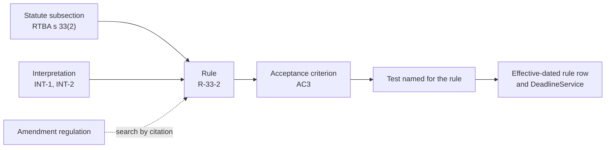

# Appendix B — Extracting business rules from legislation

A week in which the specification is a statute: the source text turned into agent context, a business-rules extract with a citation for every rule, the interpretation questions a lawyer answers, and the Unit of Work, Bolt, and merge gate that follow. There is also an amendment on Thursday. Audience: pods building systems where a misread clause is a compliance defect, and anyone who has read [Appendix A](appendix-a-worked-example.md) and wants to see the same method with law as the input instead of product intent.

The discipline is the one [Chapter 10](10-legacy-modernization.md#stage-1-comprehend-ais-home-turf) applies to legacy code: **the source is the specification, every extracted rule points back to it, and rules nobody can justify are flagged, not guessed.** What changes is who validates. For code, the old system is the oracle. For legislation, a lawyer is.

> **Warning:** The *Residential Tenancies (Bonds) Act 2026* below is invented for this example, and so are the company, people, and dates. Nothing here describes any real jurisdiction's law or is legal advice.

The scenario: Keyhold, a company approved to hold rental bonds (security deposits) on behalf of landlords and tenants, must implement bond release after a landlord's claim. The Bonds pod: Omar (Driver), Jess (Navigator), Ruth (domain anchor). Product owner Theo, QA Mei, security engineer Tomas on call. **Grace, in-house counsel, validates every interpretation.** No agent decides what the law means, and neither does the pod.

## The source text

Part 3 of the Act and the definitions it relies on, as published:

```text
RESIDENTIAL TENANCIES (BONDS) ACT 2026 — extract. In force 2026-07-01.

4  Definitions
   In this Act—
   bond means an amount paid by a tenant as security for the performance of
     the tenant's obligations under a residential tenancy agreement;
   business day means a day other than a Saturday, a Sunday, a public
     holiday, or Harvest Day (the second Monday in March);
   custodian means a person approved under Part 2 to hold bonds;
   end of the tenancy means the day on which the tenant gives vacant
     possession of the premises to the landlord;
   prescribed period means 14 business days, or such other period as is
     prescribed by regulation.

PART 3 — RELEASE OF BONDS

31 Application by tenant alone
   (1) A tenant may apply to the custodian for release of the whole bond to
       the tenant at any time after the end of the tenancy.
   (2) On receiving an application under subsection (1), the custodian must
       give notice of the application to the landlord.
   (3) If the custodian does not receive a claim from the landlord within the
       prescribed period after giving notice under subsection (2), the
       custodian must pay the bond to the tenant.

32 Claim by landlord
   (1) A landlord may make a claim for payment of all or part of the bond for—
       (a) rent owing at the end of the tenancy;
       (b) the reasonable cost of repairing damage to the premises caused by
           the tenant, other than reasonable wear and tear;
       (c) the reasonable cost of cleaning the premises to the standard they
           were in at the start of the tenancy.
   (2) A claim—
       (a) must be made in the approved form; and
       (b) must state the amount claimed under each paragraph of
           subsection (1); and
       (c) must not exceed the amount of the bond.
   (3) A landlord must give a copy of the claim to the tenant at the same
       time as the claim is made to the custodian.

33 Dispute of claim
   (1) A tenant who disputes a claim may, within the prescribed period after
       receiving a copy of the claim, give the custodian notice of dispute.
   (2) If no notice of dispute is given within that period, the custodian
       must pay the amount claimed to the landlord and any balance of the
       bond to the tenant.
   (3) If notice of dispute is given, the custodian must pay any undisputed
       amount in accordance with subsection (2) and must not pay the disputed
       amount except in accordance with section 34.

34 Resolution of disputed amounts
   (1) The custodian must pay a disputed amount in accordance with—
       (a) a written agreement between the landlord and the tenant; or
       (b) an order of the Tribunal.
   (2) If neither party applies to the Tribunal within 60 days after the
       notice of dispute is given, the custodian must pay the disputed amount
       to the tenant.
   (3) In this section, Tribunal has the same meaning as in the Civil and
       Administrative Tribunal Act 2019.
```

Five short sections, and they already contain every trap in the list: a defined term that differs from everyday usage (`business day`), "may" next to "must", a period set by regulation, a period in plain "days" beside one in business days, words the Act never defines (`reasonable wear and tear`, `receiving`), and a cross-reference to another Act.

## Monday 09:30 — The statute becomes context

Ruth commits the text to the product repo before anyone asks the agent anything. The official publication is a PDF; the conversion to markdown runs through the same Docling pipeline as the [DocLang exploration](09-documentation-standards.md#the-doclang-exploration), and Ruth checks the result line by line against the PDF, because a dropped "not" in conversion is an invisible defect.

- `docs/legislation/rtba-2026/part-3.md` holds sections 4 and 31–34, with a heading per subsection (`#### s 33(2)`) so that every citation is a stable link.
- Front-matter records the version: source URL, publication date, in-force date `2026-07-01`, and the date the text was last checked against the official copy.
- `CODEOWNERS` makes Grace a required reviewer on `docs/legislation/**` and on `docs/domain/bonds/rules.md` and `interpretations.md`.

Then the steering. Omar adds a section to the repo's `CLAUDE.md`, following the [context-engineering hierarchy](03-tooling-strategy.md#the-context-engineering-hierarchy):

```markdown
## Legislation (read before any bonds work)

- The only legal source is docs/legislation/. Do not use knowledge of any other
  jurisdiction's bond or deposit law, even when it seems to fill a gap.
- Read s 4 definitions first. A defined term never takes its everyday meaning.
- Every rule, AC, test name, and code comment that encodes a legal requirement
  cites a subsection (RTBA s 33(2)) and a rule id (R-33-2).
- Classify each provision: "must" = obligation, "may" = permission,
  "must not" = prohibition. Record whose it is.
- Never resolve an ambiguity. Record it as an open question for counsel and move on.
- A reference to legislation not in docs/legislation/ is a stop condition.
```

## Monday 10:00 — The extraction pass

Omar asks for the business-rules extract in plan mode on the frontier tier ([model selection reference](../standards/model-selection.md)); nothing is written to the repo until the pod has read the draft. The prompt is short, because the steering carries the rules: "Extract every rule in RTBA Part 3 into `docs/domain/bonds/rules.md` using the bonds ubiquitous language. One entry per subsection-level rule. Definitions as D- entries. List open questions separately."

Eleven minutes later: 3 definitions, 13 rules, 6 open questions. An excerpt of the draft as reviewed, with the two defects the review found left in and marked:

```markdown
# Business rules — bonds context

Source: docs/legislation/rtba-2026/part-3.md (in force 2026-07-01)
Status per rule: draft | confirmed (counsel, date) | superseded (by, date)

## Definitions

### D-BUSINESS-DAY
- Source: RTBA s 4 "business day"
- Statement: Monday to Friday, excluding public holidays.          ← DEFECT 1
- Status: draft

### D-PRESCRIBED-PERIOD
- Source: RTBA s 4 "prescribed period"
- Statement: 14 business days (D-BUSINESS-DAY), unless a regulation prescribes
  another period.
- Status: draft

## Rules

### R-31-3 — Tenant-only application pays out when no claim arrives
- Source: RTBA s 31(3)
- Type: obligation (custodian)
- Statement: After notifying the landlord of a tenant-only application (R-31-2),
  if no claim is received within D-PRESCRIBED-PERIOD, the custodian pays the
  whole bond to the tenant.
- Open questions: Q5
- Status: draft

### R-32-2 — A claim must be complete and within the bond
- Source: RTBA s 32(2)(a)–(c)
- Type: obligation (landlord); condition on claim validity
- Statement: A claim is in the approved form, states an amount per ground
  (rent, damage, cleaning), totals no more than the bond, and includes
  photographic evidence for any damage amount.                      ← DEFECT 2
- Open questions: Q5
- Status: draft

### R-33-1 — Tenant may dispute within the period
- Source: RTBA s 33(1)
- Type: permission (tenant)
- Statement: A tenant may give notice of dispute within D-PRESCRIBED-PERIOD after
  receiving the copy of the claim.
- Open questions: Q2, Q4
- Status: draft

### R-33-2 — Undisputed claim is paid out
- Source: RTBA s 33(2)
- Type: obligation (custodian)
- Statement: If no notice of dispute is given within the R-33-1 period, the
  custodian pays the claimed amount to the landlord and the balance to the tenant.
- Status: draft

### R-34-2 — Disputed amount goes to the tenant if nobody goes to the Tribunal
- Source: RTBA s 34(2)
- Type: obligation (custodian)
- Statement: If neither party applies to the Tribunal within 60 days after the
  notice of dispute, the custodian pays the disputed amount to the tenant.
- Open questions: Q3
- Status: draft

## Open questions for counsel

- Q1: "within the prescribed period after <event>" — is the event day counted?
- Q2: s 33(1) runs from the tenant "receiving" the copy, which the landlord
  gives (s 32(3)). The custodian cannot observe receipt. When does it start?
- Q3: s 34(2) says "60 days", not business days. Calendar days?
- Q4: s 33(3) "any undisputed amount": must a notice of dispute say which
  amounts it disputes?
- Q5: A claim that breaks s 32(2), for example one exceeding the bond. Is it a
  "claim" for s 31(3) and s 33 at all, or is it capped?
- Q6: "reasonable wear and tear" (s 32(1)(b)) is undefined. Must the custodian
  assess whether a damage amount is reasonable?
```

## Monday 10:40 — Counsel review

Grace and Jess review the draft on a shared screen. Jess's job is mechanical and comes first: **open every cited subsection and check the rule says what the text says, no more.** Grace's job is the questions.

Jess's pass finds both defects in twenty minutes:

- **Defect 1, a definition read in its everyday sense.** D-BUSINESS-DAY cites s 4 and then ignores it: the Act also excludes Harvest Day. The steering said to read definitions first. The agent read s 4, and then wrote the definition of "business day" that it has seen a thousand times elsewhere. A missing day in a deadline calculation pays a bond out a day early, on the one Monday a year nobody would test.
- **Defect 2, a rule that is not in the text.** Nothing in s 32(2) mentions photographs. Several real deposit schemes do require evidence of that kind, and the agent imported it despite the steering line forbidding exactly that. The citation made it catchable in seconds: s 32(2) is three short paragraphs, and none of them says it. Without the citation it would have read as a plausible requirement and become a validation error that rejects lawful claims.

Grace then answers the questions. Her rulings go into their own file, because a ruling is a decision with a named decider and a date, and the pod will need it again every time someone asks "why does the code do that?":

```markdown
# Interpretations — bonds context

Each entry is a decision about what RTBA means for Keyhold. Decided by counsel
(legal interpretation) or by product (policy, where the Act leaves a choice).
Superseded, never edited.

## INT-1 — Counting "within <period> after <event>"  (answers Q1)
- Kind: legal interpretation · Decided: Grace Adeyemi, counsel, 2026-09-14
- Ruling: day 1 is the first business day after the event; the period ends at
  23:59 local time on the last day.
- Rationale: the conventional reading; counting the event day would shorten
  the tenant's window.
- Affects: D-PRESCRIBED-PERIOD, R-31-3, R-33-1

## INT-2 — When the tenant "receives" the copy of the claim  (answers Q2)
- Kind: legal interpretation · Decided: Grace Adeyemi, 2026-09-14
- Ruling: Keyhold delivers the copy on the landlord's behalf through the tenant
  portal and email. Treat it as received when delivered; if delivered on a
  non-business day or after 17:00, on the next business day.
- Rationale: the Act is silent. This reading never gives the tenant a shorter
  window than the latest arguable one, so paying out under R-33-2 is safe.
- Affects: R-33-1, R-33-2

## INT-3 — "60 days" in s 34(2)  (answers Q3)
- Kind: legal interpretation · Decided: Grace Adeyemi, 2026-09-14
- Ruling: calendar days. Part 3 uses "business day" deliberately elsewhere;
  an undefined "day" takes its ordinary meaning.
- Affects: R-34-2

## INT-4 — Scope of a notice of dispute  (answers Q4)
- Kind: policy · Decided: Theo Marsh, product, 2026-09-14, on counsel's advice
- Ruling: the dispute form asks the tenant to dispute per ground (rent, damage,
  cleaning). A notice that does not specify is treated as disputing the whole claim.
- Rationale: the Act allows either design. Per-ground disputes release
  undisputed money sooner, and the fallback favours the tenant.
- Affects: R-33-3

## INT-5 — A claim that does not comply with s 32(2)  (answers Q5)
- Kind: legal interpretation · Decided: Grace Adeyemi, 2026-09-14
- Ruling: a non-compliant claim is not a claim. It is returned to the landlord
  for correction and is not capped. It does not stop the R-31-3 period.
- Rationale: s 32(2) states what a claim must be. Capping it would mean the
  custodian rewriting the landlord's claim.
- Affects: R-32-2, R-31-3

## INT-6 — Reasonableness of amounts  (answers Q6)
- Kind: legal interpretation · Decided: Grace Adeyemi, 2026-09-14
- Ruling: the custodian does not assess reasonableness or wear and tear. Those
  are for the parties and the Tribunal. No rule is implemented.
- Affects: none (recorded so nobody builds one)
```

INT-5 is the ruling that matters most. It turns a validation detail into a payment consequence: a landlord who submits an over-limit claim on day 13 and corrects it on day 15 has missed the window, and the tenant is paid under R-31-3. Nobody in the pod had asked that question. The agent had, as Q5, because the steering told it to record ambiguity rather than resolve it.

Both defects are fixed, every rule is re-cited against INT entries, and Grace approves the extract PR at 11:25. Each rule's status becomes `confirmed (counsel, 2026-09-14)`.

## Monday 11:30 — Mob Elaboration

Mob Elaboration now starts from confirmed rules, not from a paragraph of intent. Theo's intent is one line: "Landlord claims and tenant disputes are handled in the product, and money moves when the Act says it must, not when ops gets round to it." The agent drafts the Unit of Work from the extract. The pod's main edit is to the scope: tribunal orders (s 34(1)(b)) wait for a later Unit, because nobody has yet decided how an order reaches Keyhold.

```markdown
# BOND-214 — Custodian releases bonds on claim and dispute deadlines

## Intent

When a landlord claims against a bond, the claim, the tenant's dispute window,
and the resulting payments follow RTBA Part 3 automatically. Today ops tracks
deadlines in a spreadsheet; two late payments last quarter were compliance
incidents. Owner: Theo (product). Legal validator: Grace (counsel).

**Success looks like:** zero payments made before or later than the Act requires
in the first quarter after release; ops deadline spreadsheet retired.

## Domain context

- Bounded context: bonds → docs/domain/bonds/model.md
- Legal source: docs/legislation/rtba-2026/part-3.md
- Rules: docs/domain/bonds/rules.md (D-BUSINESS-DAY, D-PRESCRIBED-PERIOD,
  R-31-3, R-32-2, R-32-3, R-33-1, R-33-2, R-33-3, R-34-1a, R-34-2)
- Interpretations: INT-1 to INT-6
- Events published: ClaimLodged v1, ClaimReturned v1, DisputeNoticed v1,
  BondPaymentScheduled v2

## Stories & acceptance criteria

### Story 1 — Claims are validated and returned when non-compliant
- AC1 (R-32-2, INT-5): Given a claim whose total exceeds the bond, when it is
  lodged, then it is returned with CLAIM_EXCEEDS_BOND, ClaimReturned v1 is
  published, and the R-31-3 period is unaffected.
- AC2 (R-32-2, INT-6): Given a claim with a damage amount and no supporting
  documents, when it is lodged, then it is accepted.

### Story 2 — Deadlines drive payments
- AC3 (R-33-2, INT-1, INT-2): Given a claim copy delivered at 10:00 on a
  business day and no dispute, when the 14th business day after delivery ends,
  then payment to the landlord and balance to the tenant are scheduled.
- AC4 (D-BUSINESS-DAY): Given the period spans Harvest Day, when deadlines are
  computed, then Harvest Day is not counted.
- AC5 (R-31-3, INT-5): Given a tenant-only application, notice given, and only
  a returned claim within the period, when the period ends, then the whole
  bond is scheduled to the tenant.

### Story 3 — Disputes hold money
- AC6 (R-33-3, INT-4): Given a dispute of the damage ground only, when the
  notice is received, then rent and cleaning amounts are scheduled to the
  landlord and the damage amount is held.
- AC7 (R-34-2, INT-3): Given a held amount and no Tribunal application recorded
  within 60 calendar days, when day 60 ends, then it is scheduled to the tenant.

## Out of scope

- Payment under a Tribunal order (s 34(1)(b)): BOND-215
- Joint applications (s 30): existing behaviour, unchanged
- Assessing reasonableness of claimed amounts (INT-6: never)
```

Tomas runs the [threat-model pass](06-security-shift-left.md#inception-threat-modeling-as-elaboration): tenant and landlord PII, money movement, and one abuse case worth an AC. A landlord could lodge and withdraw claims repeatedly to reset the tenant's window. Grace confirms that withdrawal is not a claim under the Act and does not restart anything; that becomes AC8 and INT-7 the same afternoon. Classification: material (money movement and a legal obligation).

## Tuesday 09:00 — Bolt plan

The [`bolt-plan`](../standards/skills/bolt-plan/SKILL.md) skill reads the Unit, the extract, the interpretations, and ADR 0021 (money scheduling via the payments outbox) before proposing. Two sections of the approved plan differ from an ordinary Bolt:

```markdown
## Approach

Rules live as data, not scattered conditionals. `bonds/rules/periods.py` holds
effective-dated period definitions keyed by rule id (D-PRESCRIBED-PERIOD:
14 business days from 2026-07-01). `bonds/calendar.py` implements
D-BUSINESS-DAY from a calendar file that lists Harvest Day explicitly, not from
the general public-holiday library. A single `DeadlineService` computes every
deadline from (event timestamp, rule id) and applies INT-1 and INT-2 in one place.
Every function and test that encodes a rule carries its rule id in its name or docstring.

## Test strategy (extract)

| AC | Test (name) | What production failure it catches |
|---|---|---|
| AC4 | test_R_33_1_period_spanning_harvest_day_ends_2026_03_24 | Bond paid a day early every March |
| AC3 | test_R_33_2_copy_delivered_after_17_00_counts_from_next_business_day | Tenant's window cut short by an evening delivery |
| AC5 | test_R_31_3_returned_claim_does_not_stop_period | Tenant's bond frozen by an invalid claim |
| AC6 | test_R_33_3_partial_dispute_holds_only_disputed_ground | Undisputed money held for months |
| AC7 | test_R_34_2_day_60_is_calendar_not_business | Disputed amount released weeks late |

Rule coverage: CI runs scripts/check-rule-coverage.py, which fails if any
confirmed rule id in rules.md appears in no test name.

## Stop conditions (additions to the standard set)

- A rule or definition is needed that is not confirmed in rules.md
- Implementing a rule requires a reading not recorded in interpretations.md
- A reference to legislation outside docs/legislation/ must be resolved
```

Mei checks the test table against the extract the way the [test review checklist](../standards/test-review-checklist.md) asks, and adds one row the plan missed: the claim received on 2026-03-25, one business day late, must *not* stop the period. A boundary tested from one side only is not tested.

## Tuesday 09:45 to 15:30 — Mob Construction

Three moments go into the pod journal:

- **10:50, the calendar library.** The first `calendar.py` used the platform's public-holiday library and added Harvest Day on top, which looked correct. Jess asked which holidays the library considers public in this state. It included a holiday observed only in the capital, which the Act's "public holiday" may or may not cover. Rather than guess, the pod stopped: Q8 went to Grace, who ruled within the hour that "public holiday" means the state gazette's list (INT-8). The calendar became a data file generated from the gazette, with Harvest Day as its own line citing s 4.
- **12:15, a test that encoded the agent's reading.** The generated test for AC3 counted the delivery day as day 1. It passed, because the implementation made the same mistake. Mei caught it by computing the date by hand from INT-1: 2026-03-03 plus 14 business days, skipping Harvest Day, is 2026-03-24, and the test expected the 23rd. When the code and its test share an interpretation, only a check against the source ruling catches it. The fix was a test fixture of hand-computed dates, signed off by Grace, that the tests read instead of computing their own.
- **14:20, a stop condition fires.** Implementing AC7 needed "no Tribunal application recorded". The agent began modelling which applications count, including those filed with an appeal division, and then hit s 34(3): "Tribunal" has the meaning given in another Act, which is not in `docs/legislation/`. It stopped and reported instead of relying on what it knew about tribunals elsewhere. The pod narrowed AC7 to an ops-recorded `TribunalApplicationRecorded` event with no inference about what counts, and asked Grace to add the relevant part of the Tribunal Act to the source folder for BOND-215. One deviation logged in the plan, approved by Jess and Ruth.

Diff at 15:30: 530 changed lines, 30 over the budget. The rule table and the gazette calendar file account for 140 of them; the pod accepts the overrun in the plan log rather than splitting a data file.

## Wednesday 10:00 — The PR and the legal review

```markdown
BOND-214 Custodian releases bonds on claim and dispute deadlines

Unit of Work: BOND-214 · Bolt plan: docs/bolts/B-2026-09-15-a.md
Classification: material (money movement, legal obligation)
Approvers: @grace (counsel, CODEOWNERS), @tomas (security), @jess

## Rules implemented (6 of 11 shown)
| Rule | Source | Interpretations | ACs | Tests |
|---|---|---|---|---|
| D-BUSINESS-DAY | s 4 | INT-8 | AC4 | test_R_33_1_period_spanning_harvest_day_ends_2026_03_24 |
| R-31-3 | s 31(3) | INT-1, INT-5 | AC5 | test_R_31_3_returned_claim_does_not_stop_period, … |
| R-32-2 | s 32(2) | INT-5, INT-6 | AC1, AC2 | test_R_32_2_claim_exceeding_bond_returned, … |
| R-33-2 | s 33(2) | INT-1, INT-2 | AC3 | test_R_33_2_copy_delivered_after_17_00_counts_from_next_business_day, … |
| R-33-3 | s 33(3) | INT-4 | AC6 | test_R_33_3_partial_dispute_holds_only_disputed_ground |
| R-34-2 | s 34(2) | INT-3 | AC7 | test_R_34_2_day_60_is_calendar_not_business |

Rule coverage check: 11/11 confirmed rules in scope have tests.

## Deviations from plan
14:20 — AC7 narrowed to an ops-recorded TribunalApplicationRecorded event;
s 34(3) references an Act not in docs/legislation/. Follow-up: BOND-215.
Diff 530 lines (budget 500): rule table and gazette calendar data.

## Docs updated
docs/domain/bonds/rules.md (R-33-4 withdrawal, confirmed), interpretations.md
(INT-7, INT-8), model.md (Claim lifecycle), events.md (ClaimReturned v1).
```

Grace does not review the Python. She reviews what she can vouch for: the rules and interpretations diff, the rule table above, the test names, and the hand-computed date fixture. **Test names that cite rules and state outcomes are what make legal review of code possible.** She asks for one change: a test name said "tenant loses right to dispute", and the Act gives no such right to lose, only a window in which a notice has effect. The rename is a one-line change and she approves at 11:40.

CI runs the [reference pipeline](07-devops-automation.md#the-reference-pipeline-github-actions) with the rule-coverage check added. Mei walks a claim, a partial dispute, and a Harvest Day deadline through the ephemeral environment with a frozen clock. Tomas approves. Merge queue, deploy behind `bonds.auto_release`, with ops running the spreadsheet in parallel for four weeks: a [parallel run](10-legacy-modernization.md#stage-3-transform-tool-assisted-verification-led), where the old system is a spreadsheet.

## Thursday 15:00 — An amendment lands

The state gazette publishes the *Residential Tenancies (Bonds) Amendment Regulation 2027* (also invented): the prescribed period becomes 10 business days from 2027-03-01, and a transitional clause says the old period continues to apply to any notice given or copy received before that date.

Because every rule cites its source, impact analysis is a search, not a meeting. Ruth commits the regulation to `docs/legislation/rtba-2026/regulation-2027.md` and asks the agent, in plan mode: "Which rules, interpretations, tests, and code depend on D-PRESCRIBED-PERIOD?" The answer comes back in two minutes and every line of it is checkable:

- Rules: D-PRESCRIBED-PERIOD, R-31-3, R-33-1, R-33-2
- Interpretations: INT-1, INT-2 (unchanged; they concern counting, not length)
- Code: one row in `bonds/rules/periods.py`, which already supports effective dating
- Tests: 9 names containing R-31-3, R-33-1, or R-33-2
- Not affected: R-34-2 (60 calendar days, fixed in the Act)

The agent also flags the transitional clause as a new rule, R-REG27-2, and asks the question the regulation leaves open: for a tenant-only application, is the relevant event the notice (s 31(2)) or something else? Grace answers the next morning (INT-9: the date notice is given). The change becomes BOND-221: a new effective-dated row, not an edit to the old one, plus tests on both sides of 2027-03-01. The old row is marked superseded in `rules.md`; nothing is deleted, because payments made before March must stay explainable under the rule in force at the time.



## Friday 14:00 — Consolidation

The retro focuses on the two extraction defects, because both got past the steering. Three changes land, each at the cheapest level that prevents the class:

1. **A verbatim quote in every rule, checked by CI.** Each rule in `rules.md` now carries a `Quote:` field with the exact words it rests on, and a script fails the build if the quote does not appear in the cited subsection of `docs/legislation/`. Defect 2 would have failed immediately: there is no sentence about photographs to quote. This is the mechanical version of Jess's twenty-minute pass, and it runs on every change.
2. **Definitions become their own first pass.** A steering line alone did not stop Defect 1, so the extraction prompt changes shape: definitions are extracted first, reviewed by counsel, and confirmed before any rule is drafted, and rule drafting receives only the confirmed definitions as input.
3. **A hand-computed date fixture per deadline rule**, signed off by counsel, is added to the Definition of Done for this repo. The 12:15 moment showed that generated code and generated tests can share an error that only a human-computed answer exposes.

The questions log gains nine entries. Ruth notes in the journal that the extraction procedure has now been done twice (the Act, then the regulation), follows a fixed shape, and was done wrong cold both times in the same ways, which meets the bar for a [skill](../standards/skill-template.md). Drafting one is left for the next consolidation.

## What this example shows

- **Counsel is the validation gate for meaning; the agent never interprets.** The agent's best contribution on Monday was not the extract but Q5, a question nobody in the pod had thought to ask. Its two worst contributions were the moments it answered a question instead of asking one.
- **Citations make errors checkable.** An invented photographic-evidence rule is invisible in prose and obvious next to three short paragraphs. The same pointer that made it catchable by a person made it catchable by CI on Friday.
- **Definitions are where agents fail.** A term the model has seen thousands of times elsewhere is exactly the term it will read in its usual sense. Extract and confirm them first.
- **Traceability makes amendments cheap.** Subsection to rule to interpretation to AC to test to code meant Thursday's change was scoped in two minutes, and effective-dated rules kept old payments explainable.
- **Interpretations are decisions, and they need records.** INT-5 changes when money moves. Recorded with a decider and a date, it is an answer to an auditor; left in a Slack thread, it is a liability.

## References

- Templates used: [Unit of Work](../standards/unit-of-work-template.md) · [Bolt plan](../standards/bolt-plan-template.md) · [Test review checklist](../standards/test-review-checklist.md) · [CLAUDE.md](../standards/claude-md-template.md)
- Chapters exercised: [03](03-tooling-strategy.md) · [04](04-architecture.md) · [06](06-security-shift-left.md) · [07](07-devops-automation.md) · [09](09-documentation-standards.md) · [10](10-legacy-modernization.md)
- The same week with product intent as the source: [Appendix A](appendix-a-worked-example.md)
- Back to the [README](../README.md)
