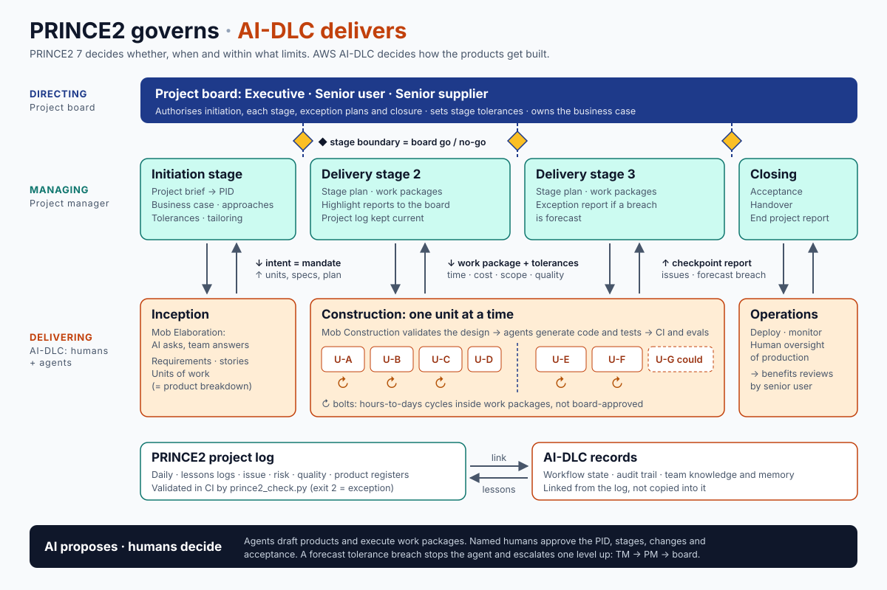

# PRINCE2 7 in an AI-driven SDLC

Two situations, often both at once:

- **A. AI does the delivery work**: coding agents (Claude Code, Kiro, Codex and similar) build the specialist products.
- **B. The project builds an AI product**: an ML model, an LLM feature or an agent is among the specialist products.

PRINCE2 sits *above* the delivery method. It governs justification, stages, tolerances and decisions, while the delivery method (Scrum, AWS AI-DLC, or a team's own agent workflow) produces the products. Don't replace one with the other: map them.

## Core rule: AI proposes, humans decide

Agents may **draft** any management product and **execute** work packages. Every decision the method assigns to a role stays with a named human:

- board authorisations (initiation, project, each stage, exception plans, closure).
- change authority decisions.
- acceptance of products.
- approval of the PID and tailoring.

An agent may never mark these as done. It records "Proposed by <agent> on <date>; awaiting <role>".

## Role mapping

| PRINCE2 role | In an AI-driven SDLC |
|---|---|
| Business layer / project board | Humans only. Senior supplier also answers for the agent toolchain's fitness (models, harness, permissions). |
| Project assurance | Humans, optionally supported by independent reviewer agents that have not seen the work (a separate context). Their findings are advice to assurance, not assurance itself. |
| Project manager | Human. Claude acts as **project support**: maintains the project log, drafts reports, runs `prince2_check.py`. |
| Team manager | Human tech lead, or an orchestrating agent working **within** a work package whose tolerances a human set. The human team manager remains accountable. |
| Team members | Coding, test and review agents plus engineers. |
| Change authority | Human. Agents raise requests for change; they never self-approve scope changes. |

## Product and control mapping

| PRINCE2 | AI-driven delivery equivalent |
|---|---|
| Project product description, product descriptions | Intent statement, specs, acceptance criteria, definition of done. Write these *before* agents generate (focus on products). |
| Product breakdown structure | Units of work / epics / backlog decomposition |
| Work package | A ticket or spec handed to an agent, carrying **explicit tolerances**: time, token or compute cost, scope (files, services, directories it may touch), quality (tests and evals that must pass), and a reporting arrangement |
| Work package tolerance breach | The agent stops and raises an issue instead of continuing. Implement as a hard budget, a scope allow-list, or a stop hook. |
| Checkpoint report | Agent run summary or PR description: what was done, what's next, tolerance usage, issues, evidence |
| Quality register | CI runs, test and eval results, code review and security scan records, each linked to the product ID |
| Off-specification | Failing acceptance tests or evals on a delivered product |
| Product register | Repo artifacts and versions, *including model IDs, prompt versions, datasets and agent configuration* |
| Daily log | Agent session logs and audit trail |
| Lessons log | Feeds back into agent instructions (CLAUDE.md, AGENTS.md, skills, steering files). This is "learn from experience" made executable. |
| Stage boundary | Human go/no-go gate. Agents prepare the end stage report and next stage plan in advance. |
| Exception report | Raised when aggregate agent cost, time or scope forecasts exceed **stage** tolerance |

## AWS AI-DLC alignment

AWS's AI-Driven Development Life Cycle (AI-DLC, announced July 2025; open-source workflows at `awslabs/aidlc-workflows`) shares the core rule above: AI leads execution, and humans hold decision rights.

Its main ideas:

- **Phases**: Inception, Construction and Operations. The v2 workflows split these into more phases and stages; check the release you use.
- **Mob Elaboration**: the AI asks clarifying questions and the cross-functional team answers them live.
- **Mob Construction**: the team validates the AI's design for one unit before code is generated.
- **Units of work**: self-contained deliverables that replace epics as the basic planning unit.
- **Bolts**: execution cycles of hours or days instead of two-week sprints.
- **Execution plans**: plans that say which stages run or are skipped, and why.
- **Approval gates**: points where the workflow stops for a human.
- **Persistent records**: workflow state, an audit trail, and team knowledge and memory that carry across cycles.

### Mapping



`assets/prince2-governs-aidlc-delivers.svg` (PNG alongside) shows this mapping on one page. Offer it when explaining the approach to a board or team, or embed it in the PID's project approach section.

| AI-DLC | PRINCE2 7 |
|---|---|
| Intent | Project mandate (if it starts a project) or a request for change / new work package (if inside one) |
| Inception phase | Starting up + Initiating a project. Mob Elaboration output feeds the project brief, project product description, product descriptions and business case. Units of work become the product breakdown structure. |
| Execution plan (stages run/skipped and why) | Tailoring, recorded at stage or work package level. Larger tailoring decisions go into the PID for board approval. |
| Construction phase, per unit | Controlling a stage (PM) + Managing product delivery (team or agents). One unit ≈ one or a few work packages. |
| Bolt | A delivery cycle *inside* a work package. Not a management stage, so don't make the board approve bolts. |
| Mob Construction design review | Quality control on the design product (record it in the quality register) |
| Approval gates | Human decision points. Map each gate to the PRINCE2 role entitled to decide it: team manager for in-tolerance design and code approvals, PM for stage-level decisions, board for stage boundaries. |
| Workflow state file | Product register + progress status for that intent |
| Audit trail | Daily log + decision evidence for assurance |
| Team knowledge / memory, learned rules | Lessons log → lessons report. Promote affirmed lessons to organisational standards at closure. |
| Operations phase | Transition / handover in Closing a project, plus post-project benefits review owned by the senior user. AWS describes this phase as still evolving, and production changes stay under human oversight. |

### Using both together

- **Management stages wrap AI-DLC cycles.** Example: Stage 1 = initiation (Inception outputs), Stage 2 = construction of units A–D, Stage 3 = construction of units E–G plus transition. Each boundary is a board decision with an updated business case.
- **Tolerances on AI-DLC work.** Set stage cost and time tolerance including model and compute spend. Set scope tolerance as which units are must-have versus could-have. A unit needing far more bolts than planned is a work package tolerance issue first; it becomes an exception only if the stage forecast breaches.
- **Point the PRINCE2 records at AI-DLC records.** Don't duplicate them. The product register can reference AI-DLC intent folders and state files; the daily log can link the audit trail. Keep the project log CSVs as the summary layer that `prince2_check.py` validates.
- **Lessons loop.** At each stage boundary, review AI-DLC learnings and memory, then decide which become lessons for the organisation versus rules for the agents.

## AI-specific content for management products

**Business case.** Include model, inference and agent usage costs (run and build), vendor lock-in and model deprecation, and productivity assumptions. Mark these as assumptions with evidence, not as facts.

**Digital and data management approach.** This is the key approach for AI work. Cover:

- what data agents and models may access, and where it may be sent (approved model providers and regions).
- PII and secrets handling.
- training and fine-tuning data provenance and licensing.
- model, prompt and dataset versioning.
- retention of agent logs.
- an AI usage policy and permitted tools.
- an evidence trail for generated code.

**Quality management approach.** Define the evals and their thresholds, test coverage expectations for generated code, mandatory human review points, security scanning, and checks for hallucinated dependencies (package existence and supply chain). For AI products, add bias, safety and robustness evaluation and the acceptance thresholds for each.

**Risk register: typical AI risks.** For each, write cause → event → effect:

- generated code contains subtle defects or insecure patterns.
- agents introduce non-existent or malicious packages.
- confidential data leaks to an external model.
- prompt injection through repo or web content.
- agent costs run away.
- the model is deprecated or its behaviour changes between versions.
- eval overfitting (passes evals, fails in production).
- licence contamination.
- over-reliance and skill atrophy in the team.
- regulatory non-compliance (for example, AI regulations relevant to the jurisdiction).

**Commercial management approach.** Cover model provider contracts, usage-based pricing, data-processing terms, IP ownership of generated output, and exit options.

**Sustainability management approach.** Cover compute and energy for training and inference, choosing smaller models where adequate, and the region carbon intensity. Set a sustainability tolerance if the organisation reports on it.

**Change management approach (people).** Cover how users and engineers adopt AI-built outputs and AI-assisted ways of working: training, trust-building, and changed roles.

**Benefits management approach.** For AI products, measure production performance (accuracy, adoption, time saved) against baseline after handover, and schedule post-project reviews. Benefits drift as models and data change.

## Stage pattern for building an AI product (B)

1. **Initiation**: problem framing, data availability check, feasibility, PID.
2. **Discovery / proof of value**: prototype and evals on real data. The boundary is a strong go/no-go point for continued business justification.
3. **Build**: increments of the model or feature with evals in CI, plus integration.
4. **Assurance and transition**: independent evaluation, security and compliance review, deployment, monitoring and handover to operations.
5. **Post-project**: benefits reviews owned by the senior user.

## Repo convention (so agents and humans share the log)

```text
project/
  pid.md, business-case.md, plans/, product-descriptions/
  log/  daily_log.csv lessons_log.csv issue_register.csv risk_register.csv
        quality_register.csv product_register.csv
  tolerances.json
  reports/  highlight-YYYY-MM-DD.md, exception-*.md, end-stage-*.md
```

Git history is the audit trail.

- Run `prince2_check.py validate project` in CI.
- Run `prince2_check.py tolerance project` before reports.
- A non-zero tolerance exit should page the PM rather than fail the build silently.
